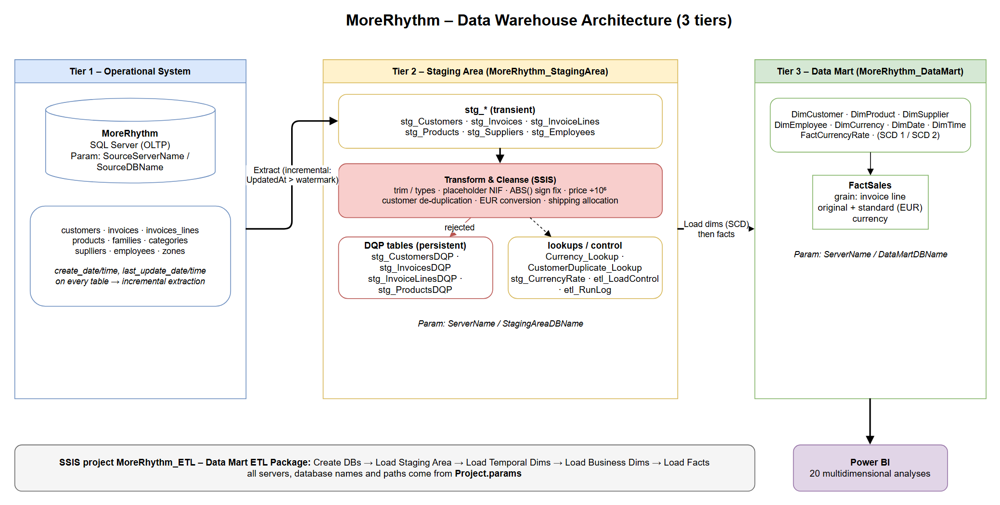
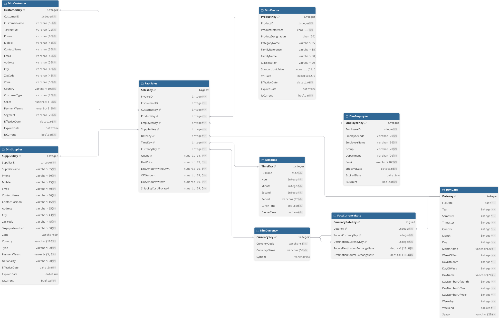

<div class="cover">
<p class="school">Instituto Superior de Engenharia do Porto<br>Departamento de Engenharia Informática</p>
<p class="course">MSc in Informatics Engineering<br><b>Armazéns de Dados (ARMDD)</b><br>2026/2027 – 1st semester</p>
<h1 class="title">MoreRhythm Data Mart</h1>
<p class="subtitle">Practical Work – Part 1<br>Architecture, Dimensional Model, Staging Area, Mapping and Data Cleansing</p>
<p class="authors">André Gonçalves – 1230794<br> Michal Binek – 1260224</p>
<p class="date">Porto, November 2026</p>
</div>

<div class="toc-page">
<h2 class="toc-title">Contents</h2>

<!-- TOC -->

</div>

## 1. Introduction

MoreRhythm, SA is a national company, headquartered in Porto, that distributes and sells musical instruments
across Portugal and occasionally in Spain. Its operational system supports billing, purchasing and stock management.
Management wants a **data mart for historical analysis of the sales made to customers**, at the lowest level of
detail, so that any analysis can be built on it, including the 10 analyses listed in the project brief.

The brief points out three characteristics of the operational data that the solution has to handle:

* the same customer may have been registered more than once, sometimes with slightly different data;
* shipping costs are recorded per invoice and not per invoice line;
* every table records when each row was inserted and when it was last changed.

The data mart must also use the **euro as the standard currency**, because the company plans to expand to other EU
countries and the United Kingdom. And the Integration Services project must have **no absolute paths**: servers,
database names and paths come from parameters.

This report covers **Part 1** of the work: data profiling of the source, the data warehouse architecture,
the dimensional model (Kimball methodology), the Staging Area structures, the mapping between source, Staging Area and
Data Mart with the SCD strategy, and the data cleansing and transformation operations. The SQL scripts, diagrams and
documentation are in the GitHub repository `ARMDD_26-27_1260224_1230794`.

The work was developed with SQL Server 2025, SQL Server Management Studio and Visual Studio 2026
(Integration Services), following the course methodology (Kimball dimensional modelling) and the conventions of the
laboratory classes.

## 2. Data Profiling

Profiling was run in SSMS against the operational database `MoreRhythm`
(script `01_Data_Profiling.sql`; raw output in `01_Data_Profiling_results.txt`).

### 2.1 Volumes

| Table | Rows | | Table | Rows |
|---|---:|---|---|---:|
| customers | 26 | | products | 67 |
| invoices | 37 | | suplliers | 14 |
| invoices_lines | 93 | | employees | 6 |
| families | 17 | | categories | 11 |
| zones | 5 | | stocks_movements / purchases | 686 / 18 |

The sample is small but, as stated in the brief, representative; the ETL is
designed for large volumes (set-based SQL, indexed staging keys, incremental extraction).

### 2.2 Customer tax numbers (`customers.taxpayer_number`)

| Finding | Records | Treatment |
|---|---|---|
| Placeholder tax numbers: `''`, `0`, `00`, `000000000` | 20, 24, 25 (internal branches), 2 ("Vendas a Dinheiro") | Not an error: set `TaxNumber = NULL`, keep the customer; excluded from NIF matching |
| **Exact duplicate** NIF `502323434` | 10 and 18 ("Eira e Beira, lda") | De-duplicate (rule M1) |
| **Near-duplicate** – NIF differs in 2 transposed digits, same zip, same/similar name | 5 ↔ 26 ("Coro Nossa Senhora Assunção" / "Coro N. Senhora Assunção"), 8 ↔ 22 ("Luz e Som, lda" / "Luz e Som Lda.") | De-duplicate (rule M2) |
| NIF fails the Portuguese modulo-11 check digit | 17 of 23 real NIFs | **Not** used as a rejection rule (would discard most of the sample); used only as a survivor tie-breaker and stored as `IsTaxNumberValid` |

### 2.3 Other customer attributes

* 1 invalid e-mail (`coro.sapo.pt`, customer 5) → set to NULL (the duplicate 26 has the valid `coro@sapo.pt`, recovered by survivorship).
* 12 customers without e-mail, 3 without city, 2 without zone (internal / cash-sale customers).
* Customer 21 (Spain): city empty, zip column holds `28108 Alcobendas - Madrid, España` → city/zip parsed; country derived from zone 5 = "Espanha".
* Zip codes hold *code + locality* (`2600-011 VILA FRANCA DE XIRA`) → split into `ZipCode` and `ZipLocality`.
* `seller` = 0 on 4 customers does not match any employee → kept as attribute only (not a FK).

### 2.4 Invoice timestamps

* `invoice_date` range 2025-01-31 … 2025-05-01; invoices are issued at month end (31-Jan, 28-Feb, 31-Mar, 30-Apr) plus one on 1-May.
* `created_at ≤ updated_at` holds for all invoices and lines.
* 36 of 37 invoices were updated after insertion and **all** have `last_update_date = payment_date` → invoices change after the sale (payment registration). The incremental load must therefore use `UpdatedAt`, not only `CreatedAt`.
* 1 invoice (`ADM06022859336,963953449`) has `create_date` 2025-02-28 but `invoice_date` 2025-03-31 (document created before its date – pre-dated draft). The business date for the fact is `invoice_date`; flagged in `QualityFlags`, not rejected.
* Invoice keys are `CHAR(25)` with trailing blanks and two prefixes (`ADM…` – 36, `cq0…` – 1) → `RTRIM` before lookup.

### 2.5 Amounts, currency and shipping

* `currency` holds only `'EURO'` (non-ISO) → mapped to `EUR`.
* Shipping cost is 2.5 % of `products_total` in 35 invoices; 2 invoices differ
  (`ADM06022868165,094314602`: 27.70 but `total_for_vat − products_total` = 25.20;
  `ADM06043059438,135478354`: 26.275 vs 21.275) → **rule S1**: when
  `shipping_cost ≠ total_for_vat − products_total`, use `total_for_vat − products_total`
  (the header's own arithmetic, which also drives the VAT and final total).
* 2 invoices have `products_total ≠ Σ line_total` (145 vs 140; 234 vs 239). In both the
  line totals are consistent with `vat_value` (`Σ line_vat = 23 % × Σ line_total`), so **lines are the
  source of truth** for the fact; the header value is only kept in staging.
* 4 lines have a negative `quantity` or `unit_price` while `line_total` is positive → sign
  error, auto-corrected with `ABS()`.
* All lines: implied VAT = 23 % = `products.vat_rate`.

### 2.6 Products / suppliers

* `current_sell_price` and `last_cost_price` are stored ×1 000 000 (e.g. 680 000 000 vs. line price 680) → divided by 10⁶.
* 2 "ghost" products (`Z001`, `CORSR`) with every attribute NULL and never sold → `stg_ProductsDQP`.
* 10 products without supplier → kept with the "Unknown supplier" member (`SupplierKey = -1`).
* Suppliers 8 and 14 share NIF `502199378` ("FaroInstrumentos" / "FaroInstrumentos II", different cities) → same company, two warehouses: kept as two suppliers (documented, not merged).

---

## 3. Data Warehouse Architecture

Three-tier architecture: operational system → Staging Area → Data Mart, consumed by Power BI
(diagram: `Design_Diagrams/Architecture_3Tier.drawio`).




**Tier 1 – Operational system (`MoreRhythm`).** The SQL Server database that supports billing,
purchasing and stock. Every table records `create_date/time` and `last_update_date/time`, which makes
incremental extraction possible. Server and database name are parameters (`SourceServerName`, `SourceDBName`).

**Tier 2 – Staging Area (`MoreRhythm_StagingArea`).** Intermediate database where the data is extracted,
cleaned and integrated before it reaches the Data Mart. It holds the transient `stg_*` tables, the persistent
`stg_*DQP` tables with the records that cannot be corrected automatically, the `_Lookup` tables, and the
ETL control tables (`etl_LoadControl`, `etl_RunLog`).

**Tier 3 – Data Mart (`MoreRhythm_DataMart`).** Star schema at the invoice-line grain: `FactSales`, `FactCurrencyRate`
and the dimensions Customer, Product, Supplier, Employee, Currency, Date and Time. It is the source for the
Power BI analyses. The Staging Area and the Data Mart are on the **same server** (`ServerName`), as the brief requires.

**ETL flow** (SSIS project `MoreRhythm_ETL`, one package `Data Mart ETL Package` organised in sequence containers, as in the labs):

1. **Create databases and tables**: creates the Staging Area and Data Mart databases if they don't exist
   and runs the `SQL Scripts` for their tables.
2. **Load Staging Area**: extracts only the rows whose `UpdatedAt` is greater than the watermark in
   `etl_LoadControl` (plus their parent/child rows) into the `stg_*` tables.
3. **Transform & cleanse**: type conversion, trimming, placeholder handling, sign correction, price-scale
   correction, currency conversion, customer de-duplication and shipping allocation. Records that cannot be
   corrected automatically go to the `stg_*DQP` table with a `DQP` message and leave the flow (Conditional
   Split / Lookup error output → Derived Column "Add … DQP" → Union All → OLE DB Destination, as in lab 4).
4. **Load Temporal Dimensions**: `DimDate` and `DimTime`, loaded once from CSV files.
5. **Load Business Dimensions**: Slowly Changing Dimension component (Type 1 / Type 2 per attribute).
6. **Load Fact Tables**: `FactCurrencyRate`, then `FactSales` with surrogate-key lookups. New lines are
   inserted and changed lines updated (matched on `InvoiceLineID`). The watermarks only move forward if the run succeeds.

## 4. Dimensional Model

### 4.1 Kimball methodology
The design of the Data Mart follows the four-step dimensional design process defined by Ralph Kimball:
1. **Business Process:** Sales and billing operations of musical instruments and accessories by More Rhythm, SA.
2. **Granularity Level:** The lowest level of detail chosen for the fact table is **each individual invoice line item (`invoices_lines`)**, ensuring maximum analytical flexibility.
3. **Dimensions:** Conformed dimensions providing descriptive context: Customer, Product, Employee, Supplier, Currency, Date, and Time.
4. **Facts / Measures:** Quantitative additive metrics per invoice line (`Quantity`, `UnitPrice`, `LineAmountWithoutVAT`, `VATAmount`, `LineAmountWithVAT`, and `ShippingCostAllocated`).

### 4.2 Star schema

The conceptual schema is organized as a **Star Schema** centered around the primary fact table `FactSales`, directly connected to the surrounding conformed dimensions via surrogate keys (`CustomerKey`, `ProductKey`, `EmployeeKey`, `SupplierKey`, `DateKey`, `TimeKey`, `CurrencyKey`). An auxiliary fact table `FactCurrencyRate` is included to support historical multi-currency conversions. Snowflake structures are avoided to maximize query performance in Power BI.




### 4.3 Dimensions

* **`DimCustomer`:** Stores customer details.
* **`DimProduct`:** Contains product attributes, integrating product families and categories hierarchies (e.g., *Ar*, *Cordas*, *Membranas* categories; *Acessórios*, *Amplificadores*, *Teclados* families).
* **`DimEmployee`:** Represents sales representatives and internal staff.
* **`DimSupplier`:** Stores supplier background and geographical zoning.
* **`DimCurrency`:** Supports multi-currency operations and EUR standardisation.
* **`DimDate` & `DimTime`:** Temporal dimensions providing calendar hierarchies and time periods.

### 4.4 Fact tables

* **`FactSales`:** The core transactional table containing foreign keys to all dimensions, degenerate dimensions (`InvoiceID`, `InvoiceLineID`), and quantitative measures: `Quantity`, `UnitPrice`, `LineAmountWithoutVAT`, `VATRate`, `VATAmount`, `LineAmountWithVAT`, and `ShippingCostAllocated`.
* **`FactCurrencyRate`:** Stores daily exchange rates between source currencies and EUR (`SourceDestinationExchangeRate`, `DestinationSourceExchangeRate`) linked via `DateKey`.

### 4.5 Attributes and data types

The following tables specify the physical schema of the Data Mart, detailing the attributes, SQL Server data types, nullability constraints, and key assignments (Primary Keys, Foreign Keys, and Degenerate Dimensions) for all dimension and fact tables. Surrogate keys (`*Key`) are implemented as auto-incrementing integers to ensure stability and decoupling from operational keys, while monetary metrics use high-precision `DECIMAL`/`NUMERIC` types to prevent rounding discrepancies during aggregations.

**DimCustomer**

| Column | Type | Null | Key |
|---|---|---|---|
| CustomerKey | int | no | PK |
| CustomerID | int | no |  |
| CustomerName | varchar(55) | no |  |
| TaxNumber | varchar(20) | no |  |
| Phone | varchar(60) | no |  |
| Mobile | varchar(45) | no |  |
| ContactName | varchar(30) | no |  |
| Email | varchar(45) | no |  |
| Address | varchar(55) | no |  |
| City | varchar(43) | no |  |
| ZipCode | varchar(45) | no |  |
| Zone | varchar(50) | no |  |
| Country | varchar(100) | no |  |
| CustomerType | varchar(20) | no |  |
| Seller | numeric(4,0) | no |  |
| PaymentTerms | numeric(3,0) | no |  |
| Segment | varchar(25) | no |  |
| EffectiveDate | datetime | no |  |
| ExpiredDate | datetime | yes |  |
| IsCurrent | bit | no |  |

**DimProduct**

| Column | Type | Null | Key |
|---|---|---|---|
| ProductKey | int | no | PK |
| ProductReference | char(18) | no |  |
| ProductDesignation | char(60) | yes |  |
| CategoryName | varchar(35) | yes |  |
| FamilyReference | varchar(18) | yes |  |
| FamilyName | varchar(60) | yes |  |
| Classification | varchar(20) | yes |  |
| StandardUnitPrice | numeric(19,6) | yes |  |
| VATRate | numeric(2,0) | yes |  |
| EffectiveDate | datetime | no |  |
| ExpiredDate | datetime | yes |  |
| IsCurrent | bit | no |  |

**DimEmployee**

| Column | Type | Null | Key |
|---|---|---|---|
| EmployeeKey | int | no | PK |
| EmployeeID | int | no |  |
| EmployeeCode | varchar(20) | no |  |
| EmployeeName | varchar(30) | no |  |
| Role | varchar(20) | no |  |
| Department | varchar(20) | no |  |
| Email | varchar(100) | no |  |
| EffectiveDate | datetime | no |  |
| ExpiredDate | datetime | yes |  |
| IsCurrent | bit | no |  |

**DimSupplier**

| Column | Type | Null | Key |
|---|---|---|---|
| SupplierKey | int | no | PK |
| SupplierID | int | no |  |
| SupplierName | varchar(55) | no |  |
| Phone | varchar(60) | no |  |
| Mobile | varchar(45) | no |  |
| Email | varchar(60) | no |  |
| ContactName | varchar(30) | no |  |
| ContactPosition | varchar(15) | no |  |
| Address | varchar(55) | no |  |
| City | varchar(43) | no |  |
| ZipCode | varchar(45) | no |  |
| TaxpayerNumber | varchar(60) | no |  |
| Zone | varchar(50) | yes |  |
| Country | varchar(100) | no |  |
| Type | varchar(20) | no |  |
| PaymentTerms | numeric(3,0) | no |  |
| Nationality | varchar(20) | no |  |
| EffectiveDate | datetime | no |  |
| ExpiredDate | datetime | yes |  |
| IsCurrent | bit | no |  |

**DimCurrency**

| Column | Type | Null | Key |
|---|---|---|---|
| CurrencyKey | int | no | PK |
| CurrencyCode | varchar(3) | no |  |
| CurrencyName | varchar(50) | no |  |
| Symbol | varchar(5) | yes |  |

**DimDate**

| Column | Type | Null | Key |
|---|---|---|---|
| DateKey | int | no | PK |
| FullDate | date | no |  |
| Year | int | no |  |
| Semester | int | no |  |
| Quarter | int | no |  |
| Month | int | no |  |
| MonthName | varchar(20) | no |  |
| WeekOfYear | int | no |  |
| DayNumberOfMonth | int | no |  |
| DayNumberOfYear | int | no |  |
| DayNumberOfWeek | int | no |  |
| Weekday | varchar(15) | no |  |
| Weekend | varchar(3) | no |  |
| Season | varchar(20) | no |  |

**DimTime**

| Column | Type | Null | Key |
|---|---|---|---|
| TimeKey | int | no | PK |
| FullTime | time | no |  |
| Hour | int | no |  |
| Minute | int | no |  |
| Second | int | no |  |
| Period | varchar(20) | no |  |
| LunchTime | varchar(3) | no |  |
| DinnerTime | varchar(3) | no |  |

**FactSales**

| Column | Type | Null | Key |
|---|---|---|---|
| InvoiceID | varchar(25) | no | PK / DD |
| InvoiceLineID | varchar(25) | no | PK / DD |
| CustomerKey | int | no | FK |
| ProductKey | int | no | FK |
| EmployeeKey | int | no | FK |
| SupplierKey | int | no | FK |
| DateKey | int | no | FK |
| TimeKey | int | no | FK |
| CurrencyKey | int | no | FK |
| Quantity | numeric(14,4) | no |  |
| UnitPriceOriginalCurrency | numeric(19,6) | no |  |
| LineAmountWithoutVATOriginalCurrency | numeric(19,6) | no |  |
| VATAmountOriginalCurrency | numeric(19,6) | no |  |
| LineAmountWithVATOriginalCurrency | numeric(19,6) | no |  |
| ShippingCostAllocatedOriginalCurrency | numeric(19,6) | no |  |
| UnitPriceStandardCurrency | numeric(19,6) | no |  |
| LineAmountWithoutVATStandardCurrency | numeric(19,6) | no |  |
| VATAmountStandardCurrency | numeric(19,6) | no |  |
| LineAmountWithVATStandardCurrency | numeric(19,6) | no |  |
| ShippingCostAllocatedStandardCurrency | numeric(19,6) | no |  |


**FactCurrencyRate**

| Column | Type | Null | Key |
|---|---|---|---|
| DateKey | int | no | PK / FK |
| SourceCurrencyKey | int | no | PK / FK |
| DestinationCurrencyKey | int | no | PK / FK |
| SourceDestinationExchangeRate | decimal(18,6) | no |  |
| DestinationSourceExchangeRate | decimal(18,6) | no |  |

## 5. Staging Area

Created by `02_Create_Staging_Tables.sql` in database `MoreRhythm_StagingArea`.

| Table | Kind | Content |
|---|---|---|
| `stg_Customers` | transient | cleaned customers (+ `SurvivorCustomerID`, normalised name, NIF validity) |
| `stg_Invoices` | transient | invoice headers, ISO currency, rate, corrected shipping, `SumLinesTotal` |
| `stg_InvoiceLines` | transient | **fact grain**: line measures, allocated shipping, all EUR measures |
| `stg_Products`, `stg_Suppliers`, `stg_Employees` | transient | dimension sources, already joined with family/category/zone/manager |
| `stg_CustomersDQP`, `stg_InvoicesDQP`, `stg_InvoiceLinesDQP`, `stg_ProductsDQP` | persistent | Data Quality Problem tables (course convention, lab 4 `CardDQP`): rejected rows (raw values as NVARCHAR) + `DQP` (problem code and description), `DQPDate`, `RunID` |
| `CustomerDuplicate_Lookup` | persistent | source customer id → surviving id (de-duplication result) |
| `Currency_Lookup` | persistent | source currency text → ISO code (`EURO` → `EUR`) |
| `stg_CurrencyRate` | transient | daily exchange rates, source of `FactCurrencyRate` |
| `etl_LoadControl` | persistent | incremental watermark (`LastUpdatedAt`) per source table |
| `etl_RunLog` | persistent | one row per ETL execution |

Every staging/error row carries `CreatedAt` / `UpdatedAt` (source `*_date + *_time`
combined into `DATETIME2`) and `RunID` for lineage.

### 5.1 Table structures

The staging tables keep the source business keys (`CustomerID`, `InvoiceID`, `InvoiceLineID`, `ProductID`, …)
so that the ETL can look up surrogate keys and match changed rows. `CreatedAt` / `UpdatedAt` drive the
incremental load, and `RunID` links each row to its row in `etl_RunLog`.

**stg_Customers**

| Column | Type | Null | Key |
|---|---|---|---|
| CustomerID | numeric(10,0) | no | PK |
| SurvivorCustomerID | numeric(10,0) | yes |  |
| CustomerName | nvarchar(55) | no |  |
| CustomerNameNorm | nvarchar(55) | yes |  |
| TaxNumber | varchar(20) | yes |  |
| IsTaxNumberValid | bit | yes |  |
| Phone | varchar(20) | yes |  |
| Mobile | varchar(20) | yes |  |
| ContactName | nvarchar(30) | yes |  |
| Email | varchar(45) | yes |  |
| Address | nvarchar(55) | yes |  |
| City | nvarchar(43) | yes |  |
| ZipCode | varchar(10) | yes |  |
| ZipLocality | nvarchar(40) | yes |  |
| Country | nvarchar(30) | yes |  |
| ZoneCode | numeric(5,0) | yes |  |
| ZoneName | nvarchar(50) | yes |  |
| CustomerType | nvarchar(20) | no |  |
| Segment | nvarchar(25) | no |  |
| SellerCode | numeric(4,0) | yes |  |
| DaysToPay | numeric(3,0) | yes |  |
| BBAN | varchar(28) | yes |  |
| CreatedAt | datetime2(0) | no |  |
| UpdatedAt | datetime2(0) | no |  |
| RunID | int | yes |  |

**stg_Invoices**

| Column | Type | Null | Key |
|---|---|---|---|
| InvoiceID | varchar(25) | no | PK |
| InvoiceDate | date | no |  |
| CustomerID | numeric(10,0) | no |  |
| SurvivorCustomerID | numeric(10,0) | yes |  |
| EmployeeID | numeric(6,0) | no |  |
| PaymentDate | date | yes |  |
| CurrencySource | varchar(11) | no |  |
| CurrencyCode | char(3) | no |  |
| ExchangeRateToEUR | decimal(19,10) | no |  |
| ProductsTotal | decimal(19,6) | no |  |
| ShippingCost | decimal(19,6) | no |  |
| TotalForVAT | decimal(19,6) | no |  |
| VATValue | decimal(19,6) | no |  |
| FinalTotal | decimal(19,6) | no |  |
| SumLinesTotal | decimal(19,6) | yes |  |
| ShippingCostEUR | decimal(19,6) | yes |  |
| QualityFlags | varchar(200) | yes |  |
| CreatedAt | datetime2(0) | no |  |
| UpdatedAt | datetime2(0) | no |  |
| RunID | int | yes |  |

**stg_InvoiceLines**

| Column | Type | Null | Key |
|---|---|---|---|
| InvoiceLineID | varchar(25) | no | PK |
| InvoiceID | varchar(25) | no |  |
| ProductID | varchar(18) | no |  |
| Quantity | decimal(14,4) | no |  |
| UnitPrice | decimal(19,6) | no |  |
| LineTotal | decimal(19,6) | no |  |
| LineVAT | decimal(19,6) | no |  |
| VATRate | decimal(5,2) | yes |  |
| ShippingAllocated | decimal(19,6) | yes |  |
| UnitPriceEUR | decimal(19,6) | yes |  |
| LineTotalEUR | decimal(19,6) | yes |  |
| LineVATEUR | decimal(19,6) | yes |  |
| LineTotalWithVATEUR | decimal(19,6) | yes |  |
| ShippingAllocatedEUR | decimal(19,6) | yes |  |
| QualityFlags | varchar(200) | yes |  |
| CreatedAt | datetime2(0) | no |  |
| UpdatedAt | datetime2(0) | no |  |
| RunID | int | yes |  |

**stg_Products**

| Column | Type | Null | Key |
|---|---|---|---|
| ProductID | varchar(18) | no | PK |
| ProductName | nvarchar(60) | no |  |
| FamilyCode | varchar(18) | yes |  |
| FamilyName | nvarchar(60) | yes |  |
| FamilyClassification | nvarchar(20) | yes |  |
| CategoryCode | int | yes |  |
| CategoryName | nvarchar(35) | yes |  |
| SupplierID | numeric(10,0) | yes |  |
| Classification | nvarchar(20) | yes |  |
| CurrentSellPrice | decimal(19,6) | yes |  |
| LastCostPrice | decimal(19,6) | yes |  |
| VATRate | decimal(5,2) | yes |  |
| CreatedAt | datetime2(0) | yes |  |
| UpdatedAt | datetime2(0) | yes |  |
| RunID | int | yes |  |

**stg_Suppliers**

| Column | Type | Null | Key |
|---|---|---|---|
| SupplierID | numeric(10,0) | no | PK |
| SupplierName | nvarchar(55) | no |  |
| TaxNumber | varchar(20) | yes |  |
| City | nvarchar(43) | yes |  |
| ZipCode | varchar(10) | yes |  |
| Country | nvarchar(30) | yes |  |
| ZoneCode | numeric(5,0) | yes |  |
| ZoneName | nvarchar(50) | yes |  |
| SupplierType | nvarchar(20) | yes |  |
| Nationality | nvarchar(20) | yes |  |
| CreatedAt | datetime2(0) | yes |  |
| UpdatedAt | datetime2(0) | yes |  |
| RunID | int | yes |  |

**stg_Employees**

| Column | Type | Null | Key |
|---|---|---|---|
| EmployeeID | numeric(6,0) | no | PK |
| EmployeeCode | varchar(20) | no |  |
| EmployeeName | nvarchar(30) | no |  |
| EmployeeGroup | nvarchar(20) | yes |  |
| Department | nvarchar(20) | yes |  |
| ManagerID | numeric(6,0) | yes |  |
| ManagerName | nvarchar(30) | yes |  |
| Email | varchar(100) | yes |  |
| CreatedAt | datetime2(0) | yes |  |
| UpdatedAt | datetime2(0) | yes |  |
| RunID | int | yes |  |

**stg_CurrencyRate**

| Column | Type | Null | Key |
|---|---|---|---|
| CurrencyCode | nchar(3) | no | PK |
| RateDate | date | no | PK |
| RateToEUR | decimal(18,6) | no |  |

**Currency_Lookup**

| Column | Type | Null | Key |
|---|---|---|---|
| SourceCurrency | nvarchar(11) | no | PK |
| CurrencyCode | nchar(3) | no |  |

**CustomerDuplicate_Lookup**

| Column | Type | Null | Key |
|---|---|---|---|
| SourceCustomerID | numeric(10,0) | no | PK |
| SurvivorCustomerID | numeric(10,0) | no |  |
| MatchRule | nvarchar(30) | no |  |
| MatchScore | decimal(5,4) | yes |  |
| RunID | int | yes |  |

**etl_LoadControl**

| Column | Type | Null | Key |
|---|---|---|---|
| SourceTable | varchar(50) | no | PK |
| LastUpdatedAt | datetime2(0) | no |  |
| LastRunID | int | yes |  |
| LastRunTime | datetime2(0) | yes |  |

**etl_RunLog**

| Column | Type | Null | Key |
|---|---|---|---|
| RunID | int | no | PK |
| PackageName | nvarchar(128) | no |  |
| StartTime | datetime2(0) | no |  |
| EndTime | datetime2(0) | yes |  |
| Status | varchar(10) | no |  |
| RowsExtracted | int | yes |  |
| RowsRejected | int | yes |  |
| RowsLoaded | int | yes |  |

**DQP tables** (`stg_CustomersDQP`, `stg_InvoicesDQP`, `stg_InvoiceLinesDQP`, `stg_ProductsDQP`) follow the
lab convention (`CardDQP`). Each has the same columns as the source table, stored as `NVARCHAR` so that values
with the wrong type or length can still be kept, plus:

| Column | Type | Null | Description |
|---|---|---|---|
| DQPID | int identity | no | primary key |
| DQP | nvarchar(200) | no | problem code and description, e.g. `C01: customer name is missing` |
| DQPDate | datetime | no | when the record was rejected (default `GETDATE()`) |
| RunID | int | yes | ETL execution that rejected it |

These tables are never truncated. Correcting the records and loading them later is out of the scope of this work, as the brief states.

## 6. Data Mapping and SCD Strategy

### 6.1 Mapping: source → Staging Area → Data Mart

The logical mapping below traces every attribute from the operational source (`MoreRhythm`), through the Staging Area (`MoreRhythm_StagingArea`), into the target Data Mart (`MoreRhythm_DataMart`), specifying all transformation rules, formulas, and associated Data Quality (DQ) codes defined in Section 7.1.

*(Note: Temporal dimensions `DimDate` and `DimTime` are **generated** once from pre-built CSV files rather than mapped from operational tables, while surrogate keys and SCD Type 2 metadata columns—`EffectiveDate`, `ExpiredDate`, `IsCurrent`—are generated during ETL execution.)*

---

#### 1. `DimCustomer` Mapping

| Source (`MoreRhythm`) | Staging (`MoreRhythm_StagingArea`) | Data Mart (`MoreRhythm_DataMart`) | Transformation / Cleansing Rule | DQ / Transf. Code |
| :--- | :--- | :--- | :--- | :--- |
| *(Generated)* | *(Generated)* | `DimCustomer.CustomerKey` | Auto-increment Surrogate Key (SK) | — |
| `customers.number` | `stg_Customers.SurvivorCustomerID` | `DimCustomer.CustomerID` | De-duplication clustering; survivor ID selected via rules M1/M2 | C05, C06 |
| `customers.name` | `stg_Customers.CustomerName` | `DimCustomer.CustomerName` | `LTRIM/RTRIM`; reject if NULL/empty | C01, C11 |
| `customers.taxpayer_number` | `stg_Customers.TaxNumber` | `DimCustomer.TaxNumber` | `LTRIM/RTRIM`; placeholders (`''`, `0`, `000000000`) → `NULL` in staging → `'N/A'` in DW; modulo-11 check flagged (`IsTaxNumberValid`) | C02, C07, C11 |
| `customers.phone` | `stg_Customers.Phone` | `DimCustomer.Phone` | `LTRIM/RTRIM`; empty → `'N/A'`; survivorship recovery | C11 |
| `customers.mobile` | `stg_Customers.Mobile` | `DimCustomer.Mobile` | `LTRIM/RTRIM`; empty → `'N/A'`; survivorship recovery | C11 |
| `customers.contact` | `stg_Customers.ContactName` | `DimCustomer.ContactName` | `LTRIM/RTRIM`; empty → `'N/A'`; survivorship recovery | C11 |
| `customers.email` | `stg_Customers.Email` | `DimCustomer.Email` | `LTRIM/RTRIM`; invalid format (no `@`) → `NULL` → recovered from duplicate or `'N/A'` | C03, C11 |
| `customers.address` | `stg_Customers.Address` | `DimCustomer.Address` | `LTRIM/RTRIM`; empty → `'N/A'` | C11 |
| `customers.clity` | `stg_Customers.City` | `DimCustomer.City` | `LTRIM/RTRIM`; if missing, parsed from `zip_code` (Spain) or set to `'Unknown'` | C08, C11 |
| `customers.zip_code` | `stg_Customers.ZipCode` | `DimCustomer.ZipCode` | Split on first space after `NNNN-NNN` (keeps code part); foreign codes kept as-is | C09, T10 |
| `customers.zone` + `zones.designation` | `stg_Customers.ZoneName` | `DimCustomer.Zone` | Lookup on `zones`; missing → `'Unknown'` | C04, T01 |
| *(Derived from Zone)* | `stg_Customers.Country` | `DimCustomer.Country` | Derived: `ZoneName = 'Espanha'` → `'Spain'`, other valid zones → `'Portugal'`, missing → `'Unknown'` | C04, T02 |
| `customers.type` | `stg_Customers.CustomerType` | `DimCustomer.CustomerType` | `LTRIM/RTRIM`; empty → `'N/A'` | C11 |
| `customers.seller` | `stg_Customers.SellerCode` | `DimCustomer.Seller` | Kept as descriptive attribute only (not a FK; `0` flagged) | C10 |
| `customers.days_to_pay` | `stg_Customers.DaysToPay` | `DimCustomer.PaymentTerms` | Direct type cast to `NUMERIC(3,0)` | — |
| `customers.segment` | `stg_Customers.Segment` | `DimCustomer.Segment` | `LTRIM/RTRIM`; empty → `'N/A'` | C11 |
| *(ETL Metadata)* | *(ETL Metadata)* | `DimCustomer.EffectiveDate` | `GETDATE()` (or `1900-01-01` on initial load) | — |
| *(ETL Metadata)* | *(ETL Metadata)* | `DimCustomer.ExpiredDate` | `NULL` while active; updated to `GETDATE()` when superseded | — |
| *(ETL Metadata)* | *(ETL Metadata)* | `DimCustomer.IsCurrent` | `1` for active version, `0` for historical versions | — |

---

#### 2. `DimProduct` Mapping

| Source (`MoreRhythm`) | Staging (`MoreRhythm_StagingArea`) | Data Mart (`MoreRhythm_DataMart`) | Transformation / Cleansing Rule | DQ / Transf. Code |
| :--- | :--- | :--- | :--- | :--- |
| *(Generated)* | *(Generated)* | `DimProduct.ProductKey` | Auto-increment Surrogate Key (SK) | — |
| `products.reference` | `stg_Products.ProductID` | `DimProduct.ProductID` | `RTRIM` trailing blanks from `CHAR(18)` | P04 |
| `products.designation` | `stg_Products.ProductName` | `DimProduct.ProductDesignation` | `LTRIM/RTRIM`; reject row if all descriptive fields are NULL | P01, C11 |
| `products.category` + `categories.designation` | `stg_Products.CategoryName` | `DimProduct.CategoryName` | Lookup on `categories`; empty → `'Unknown'` | T04 |
| `products.family` | `stg_Products.FamilyCode` | `DimProduct.FamilyReference` | `RTRIM`; empty → `'N/A'` | P04 |
| `products.family` + `families.designation` | `stg_Products.FamilyName` | `DimProduct.FamilyName` | Lookup on `families`; empty → `'Unknown'` | T03 |
| `families.classification` | `stg_Products.FamilyClassification` | `DimProduct.Classification` | Lookup on `families`; empty → `'N/A'` | T03 |
| `products.current_sell_price` | `stg_Products.CurrentSellPrice` | `DimProduct.StandardUnitPrice` | Scale correction: `current_sell_price / 1000000` | P02 |
| `products.vat_rate` | `stg_Products.VATRate` | `DimProduct.VATRate` | Direct numeric cast (`NUMERIC(2,0)`) | L05 |
| *(ETL Metadata)* | *(ETL Metadata)* | `DimProduct.EffectiveDate` | `GETDATE()` (or `1900-01-01` on initial load) | — |
| *(ETL Metadata)* | *(ETL Metadata)* | `DimProduct.ExpiredDate` | `NULL` while active; updated to `GETDATE()` when superseded | — |
| *(ETL Metadata)* | *(ETL Metadata)* | `DimProduct.IsCurrent` | `1` for active version, `0` for historical versions | — |

---

#### 3. `DimEmployee` Mapping

| Source (`MoreRhythm`) | Staging (`MoreRhythm_StagingArea`) | Data Mart (`MoreRhythm_DataMart`) | Transformation / Cleansing Rule | DQ / Transf. Code |
| :--- | :--- | :--- | :--- | :--- |
| *(Generated)* | *(Generated)* | `DimEmployee.EmployeeKey` | Auto-increment Surrogate Key (SK) | — |
| `employees.number` | `stg_Employees.EmployeeID` | `DimEmployee.EmployeeID` | Direct numeric cast (`INTEGER`) | — |
| `employees.code` | `stg_Employees.EmployeeCode` | `DimEmployee.EmployeeCode` | `LTRIM/RTRIM` | C11 |
| `employees.name` | `stg_Employees.EmployeeName` | `DimEmployee.EmployeeName` | `LTRIM/RTRIM` | C11 |
| `employees.[group]` | `stg_Employees.EmployeeGroup` | `DimEmployee.Role` | `LTRIM/RTRIM`; mapped to role description | T06, C11 |
| `employees.department` | `stg_Employees.Department` | `DimEmployee.Department` | `LTRIM/RTRIM`; empty → `'N/A'` | C11 |
| `employees.email` | `stg_Employees.Email` | `DimEmployee.Email` | `LTRIM/RTRIM`; empty → `'N/A'` | C11 |
| *(ETL Metadata)* | *(ETL Metadata)* | `DimEmployee.EffectiveDate` | `GETDATE()` (or `1900-01-01` on initial load) | — |
| *(ETL Metadata)* | *(ETL Metadata)* | `DimEmployee.ExpiredDate` | `NULL` while active; updated to `GETDATE()` when superseded | — |
| *(ETL Metadata)* | *(ETL Metadata)* | `DimEmployee.IsCurrent` | `1` for active version, `0` for historical versions | — |

---

#### 4. `DimSupplier` Mapping

| Source (`MoreRhythm`) | Staging (`MoreRhythm_StagingArea`) | Data Mart (`MoreRhythm_DataMart`) | Transformation / Cleansing Rule | DQ / Transf. Code |
| :--- | :--- | :--- | :--- | :--- |
| *(Generated)* | *(Generated)* | `DimSupplier.SupplierKey` | Auto-increment SK (`-1` reserved for `'Unknown Supplier'`) | P03 |
| `suplliers.number` | `stg_Suppliers.SupplierID` | `DimSupplier.SupplierID` | Direct numeric cast (`INTEGER`) | — |
| `suplliers.name` | `stg_Suppliers.SupplierName` | `DimSupplier.SupplierName` | `LTRIM/RTRIM` | C11 |
| `suplliers.phone` | `stg_Suppliers.Phone` *(raw)* | `DimSupplier.Phone` | `LTRIM/RTRIM`; empty → `'N/A'` | C11 |
| `suplliers.mobile` | `stg_Suppliers.Mobile` *(raw)* | `DimSupplier.Mobile` | `LTRIM/RTRIM`; empty → `'N/A'` | C11 |
| `suplliers.email` | `stg_Suppliers.Email` *(raw)* | `DimSupplier.Email` | `LTRIM/RTRIM`; empty → `'N/A'` | C11 |
| `suplliers.contact` | `stg_Suppliers.ContactName` *(raw)* | `DimSupplier.ContactName` | `LTRIM/RTRIM`; empty → `'N/A'` | C11 |
| `suplliers.contact_position` | `stg_Suppliers.ContactPosition` *(raw)* | `DimSupplier.ContactPosition` | `LTRIM/RTRIM`; empty → `'N/A'` | C11 |
| `suplliers.address` | `stg_Suppliers.Address` *(raw)* | `DimSupplier.Address` | `LTRIM/RTRIM`; empty → `'N/A'` | C11 |
| `suplliers.city` | `stg_Suppliers.City` | `DimSupplier.City` | `LTRIM/RTRIM`; missing → `'Unknown'` | S02, C11 |
| `suplliers.zip_code` | `stg_Suppliers.ZipCode` | `DimSupplier.Zip_code` | `LTRIM/RTRIM`; split code/locality where applicable | T10, C11 |
| `suplliers.taxpayer_number` | `stg_Suppliers.TaxNumber` | `DimSupplier.TaxpayerNumber` | `LTRIM/RTRIM`; shared NIFs kept separate if different cities | S01, C11 |
| `suplliers.zone` + `zones.designation` | `stg_Suppliers.ZoneName` | `DimSupplier.Zone` | Lookup on `zones`; missing → `'Unknown'` | S02, T01 |
| *(Derived from Zone)* | `stg_Suppliers.Country` | `DimSupplier.Country` | Derived: `'Espanha'` → `'Spain'`, other valid zones → `'Portugal'`, missing → `'Unknown'` | S02, T02 |
| `suplliers.type` | `stg_Suppliers.SupplierType` | `DimSupplier.Type` | `LTRIM/RTRIM`; empty → `'N/A'` | C11 |
| `suplliers.days_to_pay` | `stg_Suppliers.DaysToPay` *(raw)* | `DimSupplier.PaymentTerms` | Direct cast to `NUMERIC(3,0)` | — |
| `suplliers.nationality` | `stg_Suppliers.Nationality` | `DimSupplier.Nationality` | `LTRIM/RTRIM`; empty → `'N/A'` | C11 |
| *(ETL Metadata)* | *(ETL Metadata)* | `DimSupplier.EffectiveDate` | `GETDATE()` (or `1900-01-01` on initial load) | — |
| *(ETL Metadata)* | *(ETL Metadata)* | `DimSupplier.ExpiredDate` | `NULL` while active; updated to `GETDATE()` when superseded | — |
| *(ETL Metadata)* | *(ETL Metadata)* | `DimSupplier.IsCurrent` | `1` for active version, `0` for historical versions | — |

---

#### 5. `DimCurrency` Mapping

| Source (`MoreRhythm` / Lookup) | Staging (`MoreRhythm_StagingArea`) | Data Mart (`MoreRhythm_DataMart`) | Transformation / Cleansing Rule | DQ / Transf. Code |
| :--- | :--- | :--- | :--- | :--- |
| *(Generated)* | *(Generated)* | `DimCurrency.CurrencyKey` | Auto-increment Surrogate Key (SK) | — |
| `invoices.currency` | `Currency_Lookup.CurrencyCode` | `DimCurrency.CurrencyCode` | Map free text (`'EURO'` → `'EUR'`, `'GBP'` → `'GBP'`); reject unknown | I06, T07 |
| *(Reference Lookup)* | `Currency_Lookup` | `DimCurrency.CurrencyName` | Derived from ISO code (`'EUR'` → `'Euro'`, `'GBP'` → `'Pound Sterling'`) | T07 |
| *(Reference Lookup)* | `Currency_Lookup` | `DimCurrency.Symbol` | Derived from ISO code (`'EUR'` → `'€'`, `'GBP'` → `'£'`) | T07 |

---

#### 6. `DimDate` & `DimTime` (Generated Dimensions)

| Target Table | Generation Method & Derived Attributes | DQ / Transf. Code |
| :--- | :--- | :--- |
| **`DimDate`** | **Generated** once at initial deployment from `Files\DimDate.csv` (SQL Server Analysis Services time table generation). Not mapped from operational tables. Includes derived attributes: `DateKey` (`YYYYMMDD`), `FullDate`, `Year`, `Semester`, `Trimester`, `Quarter`, `Month`, `Day`, `MonthName`, `WeekOfYear`, `DayOfMonth`, `DayOfWeek`, `DayName`, `DayNumberOfMonth`, `DayNumberOfYear`, `DayNumberOfWeek`, `Weekday`, `Weekend` (`'Yes'`/`'No'`), and `Season` (`Spring`, `Summer`, `Autumn`, `Winter` based on meteorological/astronomical date ranges). | T08 |
| **`DimTime`** | **Generated** once at initial deployment from `Files\DimTime.csv` (86,400 daily seconds). Not mapped from operational tables. Includes derived attributes: `TimeKey` (`HHMMSS`), `FullTime`, `Hour`, `Minute`, `Second`, `Period` (`Morning`, `Afternoon`, `Evening`, `Night`), `LunchTime` (`'Yes'`/`'No'` for 12:00–14:30), and `DinnerTime` (`'Yes'`/`'No'` for 19:30–22:00). | T08 |

---

#### 7. `FactSales` Mapping

| Source (`MoreRhythm`) | Staging (`MoreRhythm_StagingArea`) | Data Mart (`MoreRhythm_DataMart`) | Transformation / Cleansing / Formula Rule | DQ / Transf. Code |
| :--- | :--- | :--- | :--- | :--- |
| `invoices.invoice_stamp_id` | `stg_Invoices.InvoiceID` | `FactSales.InvoiceID` | `RTRIM` trailing blanks; Degenerate Dimension | I10 |
| `invoices_lines.invoice_line_stamp_id` | `stg_InvoiceLines.InvoiceLineID` | `FactSales.InvoiceLineID` | `RTRIM` trailing blanks; Degenerate Dimension (Fact Grain) | I10 |
| `invoices.customer` | `stg_Invoices.SurvivorCustomerID` | `FactSales.CustomerKey` | Resolved via `CustomerDuplicate_Lookup`, then SCD Type 2 lookup on `DimCustomer` valid on `InvoiceDate` | C05, C06, I03 |
| `invoices_lines.product` | `stg_InvoiceLines.ProductID` | `FactSales.ProductKey` | `RTRIM`; SCD Type 2 lookup on `DimProduct` valid on `InvoiceDate`; reject if missing/P01 | P04, L02 |
| `invoices.employee` | `stg_Invoices.EmployeeID` | `FactSales.EmployeeKey` | SCD Type 2 lookup on `DimEmployee` valid on `InvoiceDate`; reject if not found | I03 |
| `products.supplyer` | `stg_Products.SupplierID` | `FactSales.SupplierKey` | SCD Type 2 lookup on `DimSupplier` via `ProductID`; defaults to `-1` (`Unknown`) if NULL | P03 |
| `invoices.invoice_date` | `stg_Invoices.InvoiceDate` | `FactSales.DateKey` | Formatted as integer `YYYYMMDD` (`YEAR*10000 + MONTH*100 + DAY`) to match `DimDate.DateKey`; reject if NULL/future | I01, I07 |
| `invoices.create_time` | `stg_Invoices.CreatedAt` *(time part)* | `FactSales.TimeKey` | Formatted as integer `HHMMSS` (`HOUR*10000 + MINUTE*100 + SECOND`) to match `DimTime.TimeKey` | T09 |
| `invoices.currency` | `stg_Invoices.CurrencyCode` | `FactSales.CurrencyKey` | Lookup on `DimCurrency.CurrencyCode` (`'EURO'` → `'EUR'`) | I06, T07 |
| `invoices_lines.quantity` | `stg_InvoiceLines.Quantity` | `FactSales.Quantity` | Sign correction: `ABS(quantity)` when negative with positive `line_total` | L01 |
| `invoices_lines.unit_price` | `stg_InvoiceLines.UnitPriceEUR` | `FactSales.UnitPrice` | `ABS(unit_price) * ExchangeRateToEUR` | L01, I06 |
| `invoices_lines.line_total` | `stg_InvoiceLines.LineTotalEUR` | `FactSales.LineAmountWithoutVAT` | `line_total * ExchangeRateToEUR` (after validating `|Qty * UnitPrice| == line_total`) | L03, I06 |
| `invoices_lines.line_vat` | `stg_InvoiceLines.LineVATEUR` | `FactSales.VATAmount` | If NULL: `(line_total * VATRate) * ExchangeRateToEUR`; else `line_vat * ExchangeRateToEUR` | L05, I06 |
| *(Derived)* | `stg_InvoiceLines.LineTotalWithVATEUR` | `FactSales.LineAmountWithVAT` | Formula: `(LineTotal + LineVAT) * ExchangeRateToEUR` | I06 |
| `invoices.shipping_cost` | `stg_InvoiceLines.ShippingAllocatedEUR` | `FactSales.ShippingCostAllocated` | Proportional allocation + rounding residual adjustment: `ROUND(Ship* * (LineTotal / SUM(LineTotal)), 6) * ExchangeRateToEUR` (where `Ship* = TotalForVAT - ProductsTotal` if `shipping_cost` differs) | I04 |

---

#### 8. `FactCurrencyRate` Mapping

| Source (External ECB File) | Staging (`MoreRhythm_StagingArea`) | Data Mart (`MoreRhythm_DataMart`) | Transformation / Cleansing / Formula Rule | DQ / Transf. Code |
| :--- | :--- | :--- | :--- | :--- |
| *(Generated)* | *(Generated)* | `FactCurrencyRate.CurrencyRateKey` | Auto-increment Surrogate Key (`BIGINT`) | — |
| `CurrencyRates.csv (RateDate)` | `stg_CurrencyRate.RateDate` | `FactCurrencyRate.DateKey` | Formatted as integer `YYYYMMDD` to match `DimDate.DateKey` | — |
| `CurrencyRates.csv (SourceCode)` | `stg_CurrencyRate.CurrencyCode` | `FactCurrencyRate.SourceCurrencyKey` | Lookup against `DimCurrency.CurrencyCode` | T07 |
| `CurrencyRates.csv (TargetCode)` | *(Fixed `'EUR'` / Target)* | `FactCurrencyRate.DestinationCurrencyKey` | Lookup against `DimCurrency.CurrencyCode` | T07 |
| `CurrencyRates.csv (RateToEUR)` | `stg_CurrencyRate.RateToEUR` | `FactCurrencyRate.SourceDestinationExchangeRate` | Direct cast to `DECIMAL(18,6)` (`1.000000` for `EUR -> EUR`) | — |
| *(Derived)* | *(Derived)* | `FactCurrencyRate.DestinationSourceExchangeRate` | Inverse rate formula: `ROUND(1.0 / NULLIF(RateToEUR, 0), 6)` | — |

### 6.2 SCD Strategy (Slowly Changing Dimensions)

To handle changes in dimensional attributes over time, the SSIS Slowly Changing Dimension component configuration is structured using **Type 1 (Overwriting)** and **Type 2 (Historical Versioning)** strategies. 

#### Summary of SCD Attribute Classification per Dimension

#### 1. `DimCustomer`
* **Fixed / Business Key:** `CustomerID` (Unchanging natural identifier).
* **Changing (Type 1 - Overwriting):** `Phone`, `Mobile`, `ContactName`, `Email`. 
  * *Justification:* Contact details are operational attributes; correcting a typo or updating a phone number should overwrite current records without altering past sales context.
* **Historical (Type 2 - Versioning):** `CustomerName`, `TaxNumber`, `Address`, `City`, `ZipCode`, `Zone`, `Country`, `CustomerType`, `Seller`, `PaymentTerms`, `Segment`.
  * *Justification:* These attributes define geographical grouping, customer segmentation, and business behavior. If a customer changes address or moves to another sales zone, historical sales must remain associated with the zone and address active at the exact time of the transaction.

#### 2. `DimProduct`
* **Fixed / Business Key:** `ProductID`.
* **Changing (Type 1 - Overwriting):** `StandardUnitPrice`.
  * *Justification:* Standard prices can be overwritten for future transactions, while historical transaction pricing is safely captured by the unit price measures directly inside the fact table (`FactSales`).
* **Historical (Type 2 - Versioning):** `ProductDesignation`, `CategoryName`, `FamilyReference`, `FamilyName`, `Classification`, `VATRate`.
  * *Justification:* Products moving between categories or families must preserve historical reporting integrity. Filtering sales by family/category across different periods requires Type 2 versioning.

#### 3. `DimEmployee`
* **Fixed / Business Key:** `EmployeeID`, `EmployeeCode`.
* **Changing (Type 1 - Overwriting):** `EmployeeName`, `Email`.
  * *Justification:* Minor corrections to a name spelling or email updates do not impact historical sales performance evaluations.
* **Historical (Type 2 - Versioning):** `Role`, `Department`.
  * *Justification:* Employees transferring between departments or organizational roles must have their sales performance correctly attributed to the department they belonged to at the time of each sale.

#### 4. `DimSupplier`
* **Fixed / Business Key:** `SupplierID`.
* **Changing (Type 1 - Overwriting):** `Phone`, `Mobile`, `Email`, `ContactName`, `ContactPosition`.
  * *Justification:* Purely operational supplier contact data updated via Type 1.
* **Historical (Type 2 - Versioning):** `SupplierName`, `Address`, `City`, `Zip_code`, `TaxpayerNumber`, `Zone`, `Country`, `Type`, `PaymentTerms`, `Nationality`.
  * *Justification:* Supplier location and contractual classification affect geographic and supply-chain reporting over time.

#### 5. `DimCurrency`, `DimDate`, & `DimTime`
* **Fixed (Type 0 / Static):** All attributes in `DimCurrency`, `DimDate`, and `DimTime` are treated as static/fixed. Dates, times, and ISO currency definitions represent immutable temporal or international standards and do not change.

---

#### Justification for Excluding Types 3, 4, and 6
* **Type 3 (Previous Value columns):** Not used because it only preserves a single prior version (e.g., "Previous Address"), which is inadequate for multi-year historical analyses where customers might change locations multiple times.
* **Type 4 (Mini-Dimension / History Table):** Not used because splitting rapidly changing attributes into a separate mini-dimension introduces unnecessary complexity and joins, whereas Type 2 row-versioning handles the historical depth cleanly within the main dimension tables.
* **Type 6 (Hybrid):** Not used because combining Type 1, 2, and 3 behaviours introduces excessive complexity and redundant data maintenance, whereas strict separation between Type 1 (operational edits) and Type 2 (analytical history) satisfies all business requirements cleanly.

---

#### Technical Execution of Type 2 Versioning
When a Type 2 attribute changes:
1. The existing active record is expired by updating `IsCurrent = 0` and setting `ExpiredDate = GETDATE()`.
2. A new record is inserted with the updated attribute values, `IsCurrent = 1`, `EffectiveDate = GETDATE()`, and a newly generated surrogate key (`CustomerKey`, `ProductKey`, etc.).
3. **Fact Lookup Mechanism:** When loading `FactSales`, the foreign key lookup matches the source business entity and evaluates the transaction date (`DateKey` mapped to `FullDate`), ensuring the fact table links exclusively to the dimension version valid on the exact invoice date (`FullDate BETWEEN EffectiveDate AND ISNULL(ExpiredDate, '9999-12-31')`).

## 7. Data Quality, Cleansing and Transformations

### 7.1 Data quality problems and how each is handled

Every problem found by profiling (or that the ETL must guard against on future
data) gets one of three treatments:

* **AUTO-CORRECT**: the ETL can repair the value deterministically. The record is loaded. For invoices and lines the fix is also noted in the `QualityFlags` column of `stg_Invoices` / `stg_InvoiceLines`.
* **FLAG**: the value is suspicious but not wrong enough to block the record. The record is loaded unchanged and flagged.
* **REJECT**: no automatic correction is possible. The record is written to the matching `stg_<Table>DQP` table with a `DQP` message (problem code + description), removed from `stg_*`, and **never loaded into the Data Mart**, as the brief requires. Correcting and reloading rejected records is out of scope.

"Rows in sample" is the number of records affected in the data provided
(`01_Data_Profiling_results.txt`); 0 means the rule is a safeguard for future loads.

#### Customers (`customers` → `stg_Customers` / `stg_CustomersDQP`)

| Code | Problem | Attribute(s) | Rows in sample | Treatment | How |
|---|---|---|---:|---|---|
| C01 | Name missing | name | 0 | REJECT → `stg_CustomersDQP` | a customer cannot be identified without a name |
| C02 | Placeholder tax number (`''`, `0`, `00`, `000000000`) | taxpayer_number | 4 (ids 2, 20, 24, 25) | AUTO-CORRECT | `TaxNumber = NULL` in staging, `'N/A'` in DimCustomer; record kept (internal branches / cash sales); excluded from NIF matching |
| C03 | Invalid e-mail format (no `@`) | email | 1 (id 5: `coro.sapo.pt`) | AUTO-CORRECT | `Email = NULL`; then recovered from duplicate id 26 (`coro@sapo.pt`) by survivorship |
| C04 | Zone missing | zone | 2 (ids 2, 20) | AUTO-CORRECT | `Zone = 'Unknown'`, `Country = 'Unknown'` |
| C05 | Exact duplicate (same NIF) | taxpayer_number | 1 group (ids 10, 18) | AUTO-CORRECT (merge) | de-duplication rule M1 (Section 7.2) |
| C06 | Near-duplicate (NIF typo, name variant, same zip) | name, taxpayer_number, zip_code | 2 groups (5 ↔ 26, 8 ↔ 22) | AUTO-CORRECT (merge) | de-duplication rule M2 (Section 7.2) |
| C07 | NIF fails modulo-11 check digit | taxpayer_number | 17 of 23 | FLAG | `IsTaxNumberValid = 0`; used only to pick the survivor (rejecting would discard most customers) |
| C08 | City missing | clity | 3 (ids 2, 20, 21) | AUTO-CORRECT | id 21: city parsed from zip text ("Alcobendas - Madrid"); others → `'Unknown'` |
| C09 | Zip code and locality stored together; foreign format | zip_code | 24 / 1 foreign (id 21) | AUTO-CORRECT | split into `ZipCode` (`NNNN-NNN`) + `ZipLocality`; foreign codes kept as they are |
| C10 | Seller code does not match an employee | seller | 4 (seller = 0) | FLAG | kept as a descriptive attribute only, not used as a foreign key |
| C11 | Text with extra spaces / inconsistent case | all text | all | AUTO-CORRECT | `LTRIM/RTRIM`; empty string → NULL in staging, `'N/A'` in the Data Mart |

#### Products and suppliers (`products`, `suplliers` → `stg_Products`, `stg_Suppliers` / `stg_ProductsDQP`)

| Code | Problem | Attribute(s) | Rows in sample | Treatment | How |
|---|---|---|---:|---|---|
| P01 | Product with every descriptive attribute NULL | designation, family, category | 2 (`Z001`, `CORSR`) | **REJECT → `stg_ProductsDQP`** | never sold, so nothing cascades to sales |
| P02 | Price stored ×1 000 000 | current_sell_price, last_cost_price | 65 (all non-null) | AUTO-CORRECT | ÷ 1 000 000 (checked against line `unit_price`: ratio = 10⁶) |
| P03 | Product without supplier | supplyer | 10 | AUTO-CORRECT | `SupplierKey = -1` (Unknown member of DimSupplier) |
| P04 | Product reference with trailing blanks (`CHAR(18)`) | reference | all | AUTO-CORRECT | `RTRIM` before lookups |
| S01 | Two suppliers share a NIF | taxpayer_number | 1 pair (8, 14 "FaroInstrumentos"/"II") | FLAG | different cities, so treated as two warehouses of one company; not merged |
| S02 | Supplier zone / city missing | zone, city | 2 (3 "Compras a Dinheiro", 13 internal) | AUTO-CORRECT | `Zone`, `City`, `Country = 'Unknown'` |

#### Invoices (`invoices` → `stg_Invoices` / `stg_InvoicesDQP`)

| Code | Problem | Attribute(s) | Rows in sample | Treatment | How |
|---|---|---|---:|---|---|
| I01 | Invoice date NULL or in the future | invoice_date | 0 | REJECT → `stg_InvoicesDQP` | no valid date means no `DateKey` |
| I02 | Invoice without lines | — | 0 | REJECT → `stg_InvoicesDQP` | nothing to load at the fact grain |
| I03 | Customer or employee not found | customer, employee | 0 | REJECT → `stg_InvoicesDQP` | broken foreign key |
| I04 | Shipping ≠ `total_for_vat − products_total` | shipping_cost | 2 | AUTO-CORRECT | rule S1: use `total_for_vat − products_total` |
| I05 | `products_total` ≠ Σ `line_total` | products_total | 2 | FLAG | lines are consistent with the VAT, so lines are used for the fact |
| I06 | Currency not ISO / unknown / no exchange rate | currency | 37 non-ISO (`EURO`), 0 unknown | AUTO-CORRECT (`EURO → EUR`); unknown currency → REJECT | mapping through `Currency_Lookup` |
| I07 | Record created before its invoice date | create_date | 1 | FLAG | `invoice_date` is the business date for the fact |
| I08 | Payment date before invoice date | payment_date | 0 | FLAG | safeguard |
| I09 | Created after updated | create_*, last_update_* | 0 | FLAG | safeguard (would break the incremental watermark) |
| I10 | Invoice key padded to `CHAR(25)` | invoice_stamp_id | 37 | AUTO-CORRECT | `RTRIM` |

#### Invoice lines (`invoices_lines` → `stg_InvoiceLines` / `stg_InvoiceLinesDQP`)

| Code | Problem | Attribute(s) | Rows in sample | Treatment | How |
|---|---|---|---:|---|---|
| L01 | Negative quantity or unit price while `line_total` is positive | quantity, unit_price | 4 | AUTO-CORRECT | `ABS()` (sign entry error; `line_total` and VAT confirm the positive value) |
| L02 | Product not found or rejected (P01) | product | 0 | REJECT → `stg_InvoiceLinesDQP` | no `ProductKey` |
| L03 | `|quantity × unit_price| ≠ line_total` (beyond 0.01) | line_total | 0 | REJECT → `stg_InvoiceLinesDQP` | the correct amount cannot be known |
| L04 | Line belongs to a rejected invoice | invoice_stamp_id | 0 | REJECT → `stg_InvoiceLinesDQP` (cascade) | keeps fact and header consistent |
| L05 | VAT NULL or ≠ `line_total × vat_rate` | line_vat | 0 (all 23 %) | NULL → AUTO-CORRECT (recompute from rate); mismatch → FLAG | |

**Result on the provided sample:** 2 records are rejected (products `Z001`
and `CORSR`, which were never sold). Every customer, invoice and invoice line can be
corrected automatically, so the Data Mart receives 23 customers (after merging 3
duplicate pairs), 37 invoices and all 93 lines, with shipping and amounts
reconciled.

#### Transformations that make values explicit (no data quality problem)

As in lab 4 (`Gender` F → Female), every code is replaced by a value whose meaning is clear at analysis time:

| Code | Source | Data Mart | Transformation |
|---|---|---|---|
| T01 | `customers.zone`, `suplliers.zone` (1–5) | `Zone` | Lookup on `zones` → Norte, Centro, Sul, Ilhas, Espanha |
| T02 | zone | `Country` | derived: Espanha → Spain, other zones → Portugal |
| T03 | `products.family` (reference) | `FamilyName`, `FamilyClassification` | Lookup on `families` |
| T04 | `products.category` (code) | `CategoryName` | Lookup on `categories` |
| T05 | `employees.chief` (number) | `ManagerName` | self-lookup on `employees`; `'N/A'` for top management |
| T06 | `employees.[group]` | `Role` | renamed attribute (Vendedor, Administrativo, Administrador) |
| T07 | `invoices.currency` (`EURO`) | `DimCurrency.Code`, `Name`, `Symbol` | `Currency_Lookup` → ISO code → DimCurrency |
| T08 | dates / times | `Weekend`, `LastDayOfMonth`, `LunchTime`, `DinnerTime` | `'Yes'` / `'No'` instead of 1/0 |
| T09 | `create_date` + `create_time`, `last_update_date` + `last_update_time` | `CreatedAt`, `UpdatedAt` (staging) | combined into one `DATETIME2` |
| T10 | `zip_code` (`2600-011 VILA FRANCA DE XIRA`) | `PostalCode` + locality | split on the first space after the `NNNN-NNN` code |

### 7.2 Customer de-duplication

**Input:** `stg_Customers` (new/changed customers) and the customers already in
`DimCustomer`. **Output:** `CustomerDuplicate_Lookup` (every source id → survivor id) and
one surviving, merged record per real customer.

1. **Standardise** every record:
   * `NameNorm` = UPPER, accent-insensitive (`COLLATE Latin1_General_CI_AI`),
     punctuation removed, legal suffixes removed (`LDA`, `S.A.`, `UNIPESSOAL`),
     abbreviations expanded (`N.` → `NOSSA`, `SRA` → `SENHORA`, `R.` → `RUA`, `AV.` → `AVENIDA`), multiple spaces collapsed;
   * `AddressNorm` the same way; `Phone`/`Mobile` → digits only;
   * `ZipCode` = first 8 characters (`NNNN-NNN`);
   * `TaxNumber` = NULL if blank or only zeros (rule C02); `IsTaxNumberValid` = modulo-11 check.
2. **Exclude non-matchable records** from the comparison: customers of type
   `Interno` and generic customers ("Vendas a Dinheiro") – each is its own survivor.
3. **Blocking** (to avoid comparing all n² pairs on large volumes): only compare
   records that share **NIF**, or **ZipCode**, or **Phone**.
4. **Matching rules** for each candidate pair (A, B):
   * **M1 – exact identifier:** `A.TaxNumber = B.TaxNumber` (not NULL) → duplicate, score 1.0.
   * **M2 – fuzzy:** same `ZipCode` **and** name similarity ≥ 0.80
     (SSIS *Fuzzy Grouping* on `NameNorm`, `AddressNorm`) **and** at least one
     corroborating evidence: NIF differs in ≤ 2 digits, **or** same phone, **or**
     address similarity ≥ 0.80 → duplicate, score = similarity.
   * Otherwise → distinct customers.
5. **Clustering:** take the transitive closure of the matched pairs (if A≈B and
   B≈C then {A,B,C} is one group).
6. **Survivor selection** inside each group, in order:
   1. record already present in `DimCustomer` (keeps the surrogate key stable);
   2. record with a valid NIF check digit;
   3. most complete record (largest number of non-empty attributes);
   4. earliest `CreatedAt` (the original registration);
   5. lowest `CustomerID`.
7. **Survivorship per attribute:** survivor values win; empty/invalid survivor
   attributes are filled from the other members with the most recent `UpdatedAt`
   (e.g. customer 5's invalid e-mail is replaced by customer 26's `coro@sapo.pt`).
8. **Persist** `CustomerDuplicate_Lookup(SourceCustomerID, SurvivorCustomerID, MatchRule, MatchScore)`;
   only survivors are loaded into `DimCustomer`.
9. **Re-key facts:** `stg_Invoices.SurvivorCustomerID` is set through the map, so
   sales of all duplicates are attributed to the same `CustomerKey`.
10. **Incremental runs:** new customers are matched against `DimCustomer` as
    well; an existing map entry is never re-pointed automatically (manual review).

**Result on the provided data** (validated in SQL): 3 groups, 0 false positives –
{10, 18} by M1, {5, 26} and {8, 22} by M2. 26 source customers → 23 customers in the Data Mart.

**Survivor of each group** (rules of step 6 applied to the data; none of them is in `DimCustomer` yet, and none has a valid check digit except group 1, where both NIFs are equal and valid):

| Group | Members | Rule | Completeness (filled contact/address fields) | Survivor | Reason |
|---|---|---|---|---|---|
| 1 | 10, 18 "Eira e Beira, lda" | M1 | 6 / 6 | **10** | tie on completeness → created first (2025-03-31 vs 2025-05-31) |
| 2 | 5 "Coro Nossa Senhora Assunção", 26 "Coro N. Senhora Assunção" | M2 | 5 / 6 | **26** | more complete (valid e-mail, mobile); customer 5's contact name is kept by attribute survivorship |
| 3 | 8 "Luz e Som, lda", 22 "Luz e Som Lda." | M2 | 5 / 5 | **8** | tie on completeness → created first (2025-04-30 vs 2025-06-30); phone taken from 22 |

**Validation query** (finds the candidate pairs with rules M1 and M2; result: exactly the 3 pairs above):

```sql
WITH c AS (
  SELECT number, zip_code,
         LTRIM(RTRIM(REPLACE(REPLACE(REPLACE(REPLACE(REPLACE(REPLACE(
             UPPER(name) COLLATE Latin1_General_CI_AI, ',', ' '), '.', ' '), ' LDA', ' '),
             ' S A', ' '), ' N ', ' NOSSA '), '  ', ' '))) AS NameNorm,
         taxpayer_number AS nif,
         CASE WHEN taxpayer_number LIKE '%[^0]%' AND LEN(taxpayer_number) = 9 THEN 1 ELSE 0 END AS real_nif
  FROM MoreRhythm.dbo.customers
)
SELECT a.number AS customer_a, b.number AS customer_b,
       CASE WHEN a.real_nif = 1 AND a.nif = b.nif THEN 'M1' ELSE 'M2' END AS match_rule
FROM c a JOIN c b ON a.number < b.number
WHERE (a.real_nif = 1 AND a.nif = b.nif)
   OR (a.zip_code = b.zip_code AND a.zip_code <> '' AND DIFFERENCE(a.NameNorm, b.NameNorm) = 4);
```

In SSIS, the same matching is done with the **Fuzzy Grouping** transformation on `NameNorm`, `AddressNorm`
and `ZipCode` (exact match on `ZipCode`), with a similarity threshold of 0.80.

### 7.3 Shipping-cost allocation

Shipping is recorded only on the invoice header; the fact grain is the invoice
line, so the cost is allocated **proportionally to the line value excluding VAT**.

For invoice *i* with lines *j = 1…nᵢ*:

$$
\text{Ship}_{i}^{*} =
\begin{cases}
\text{TotalForVAT}_i - \text{ProductsTotal}_i & \text{if } \text{ShippingCost}_i \neq \text{TotalForVAT}_i - \text{ProductsTotal}_i \ (\text{rule S1})\\
\text{ShippingCost}_i & \text{otherwise}
\end{cases}
$$

$$
\text{ShippingAllocated}_{ij} = \operatorname{round}_6\!\left(\text{Ship}_{i}^{*} \times \frac{\text{LineTotal}_{ij}}{\sum_{k=1}^{n_i}\text{LineTotal}_{ik}}\right)
$$

Rounding residual (so the line shares add up exactly to the header):

$$
\text{ShippingAllocated}_{i,j^{*}} \mathrel{+}= \text{Ship}_{i}^{*} - \sum_{j=1}^{n_i}\text{ShippingAllocated}_{ij},
\qquad j^{*} = \arg\max_j \text{LineTotal}_{ij}
$$

$$
\text{ShippingCostOriginalCurrency}_{ij} = \text{ShippingAllocated}_{ij}, \qquad
\text{ShippingCostStandardCurrency}_{ij} = \text{ShippingAllocated}_{ij} \times \text{rate}_{i \to EUR}
$$

**Why proportional and not an equal split.** The slides ("Header & Line Facts
with Different Granularities") use the lab example to show that the header value
must not be copied to every line. Copying freight 15 to 3 lines would sum to 45.
The example splits it equally (5 + 5 + 5). We use the same allocation idea, but
weight by line value. A 1 322 € guitar line and a 56 € case line on the same
invoice should not carry the same shipping cost. Both methods keep the total
exact (Σ lines = header).

Notes

* `LineTotal` is used **after** the sign correction (L01), so weights are never negative.
* If `Σ LineTotal = 0` (all lines free of charge) the cost is split by quantity:
  `Ship* × Quantity_ij / Σ Quantity_ik`.
* The denominator is the **sum of the lines** (not the header `products_total`,
  which is wrong in 2 invoices), guaranteeing `Σ_j ShippingAllocated_ij = Ship*_i`.
* Worked example – invoice `ADM06013159066,541488606`, shipping 51.45, lines 680 + 56 + 1322 = 2058:
  680/2058 × 51.45 = 17.00; 56/2058 × 51.45 = 1.40; 1322/2058 × 51.45 = 33.05; total 51.45.
* Validation on the full sample (37 invoices, 93 lines): Σ allocated = 990.395 = Σ invoice shipping, and the line shares of every invoice add up exactly to its shipping cost (0 mismatches).

SQL implementation (Transform & Cleanse step of the `Data Mart ETL Package`, Execute SQL Task on the Staging Area):

```sql
WITH l AS (
  SELECT l.InvoiceLineID, l.InvoiceID, l.LineTotal, i.ShippingCost,
         SUM(l.LineTotal) OVER (PARTITION BY l.InvoiceID) AS SumLines,
         ROW_NUMBER() OVER (PARTITION BY l.InvoiceID ORDER BY l.LineTotal DESC, l.InvoiceLineID) AS rn
  FROM stg_InvoiceLines l JOIN stg_Invoices i ON i.InvoiceID = l.InvoiceID
), a AS (
  SELECT *, ROUND(ShippingCost * LineTotal / NULLIF(SumLines,0), 6) AS Alloc FROM l
), b AS (
  SELECT InvoiceLineID,
         Alloc + CASE WHEN rn = 1 THEN ShippingCost - SUM(Alloc) OVER (PARTITION BY InvoiceID) ELSE 0 END AS AllocFinal
  FROM a
)
UPDATE t SET ShippingAllocated = b.AllocFinal
FROM stg_InvoiceLines t JOIN b ON b.InvoiceLineID = t.InvoiceLineID;
```

## 8. Currency Standardisation and SSIS Parameterisation

### 8.1 EUR multi-currency standardisation

Requirement: the company will expand to other EU countries and to the UK, so
the Data Mart uses the **euro as the reporting currency** while still allowing
analysis by original currency.

**Design** (the "Multiple Currencies" technique from the Dimensional Data
Modeling slides, also used in the resolution of modelling exercise 4):

1. **Normalise the currency code.** Source values are free text (`'EURO'`). A
   Lookup against `Currency_Lookup` maps them to ISO-4217 codes
   (`EURO → EUR`; later `LIBRA`/`GBP → GBP`, etc.). A currency with no match
   cannot be corrected automatically → `stg_InvoicesDQP` (`I06: unknown currency`).
2. **Currency dimension** `DimCurrency(CurrencyKey, Code, Name, Symbol)`: the
   fact references the currency in which the invoice was issued.
3. **Pairs of facts.** Each money fact of `FactSales` is stored twice: in the
   **original (local) currency** and in the **standard currency (EUR)**:
   `UnitPrice…`, `Amount…` (excl. VAT), `VATAmount…`, `TotalAmount…` (incl. VAT),
   `ShippingCost…` (allocated), each with the suffix `OriginalCurrency` or
   `StandardCurrency`. EUR facts can be added across all invoices; original facts
   can be analysed by filtering on one currency.
4. **Currency conversion fact table** `FactCurrencyRate(DateKey, SourceCurrencyKey,
   DestinationCurrencyKey, SourceDestinationExchangeRate, DestinationSourceExchangeRate)`
   keeps the daily rates in **both directions**, because the two directions are not
   always symmetric. This lets analyses be shown in any currency the user selects,
   not only EUR. Rates are loaded from a daily rates file (e.g. ECB reference rates)
   into `stg_CurrencyRate`; EUR → EUR has rate 1 for every date.
5. **Conversion at load time**: the rate used is the one for the invoice date
   (or the latest earlier date with a rate):

```sql
SELECT TOP (1) r.SourceDestinationExchangeRate
FROM FactCurrencyRate r
JOIN DimDate d ON d.DateKey = r.DateKey
WHERE r.SourceCurrencyKey = @InvoiceCurrencyKey
  AND r.DestinationCurrencyKey = @EURKey
  AND d.FullDate <= @InvoiceDate
ORDER BY d.FullDate DESC;
-- <Fact>StandardCurrency = <Fact>OriginalCurrency × rate
```

6. The rate is fixed at load time (the historical rate of the invoice date). If a
   rate is corrected later, the invoice's `UpdatedAt` does not change, so the affected
   period has to be reloaded manually. This is a documented limitation.

With the current data all invoices are EUR (rate = 1), so both values of every pair
are equal. The mechanism is in place for the expansion to the UK.

### 8.2 SSIS project parameterisation

Requirement: **no absolute paths or server/database names inside components**.
The first four parameters are the ones defined in lab exercise 2 (same names).
The two `Source…` parameters are added because the project brief also requires
the operational database server and name to be configurable.

| Parameter | Type | Default (dev) | Used by |
|---|---|---|---|
| `ServerName` | String | `localhost` | Staging Area & Data Mart connections (same server) |
| `StagingAreaDBName` | String | `MoreRhythm_StagingArea` | `CM_StagingArea`; "Create Staging Area Database" task (`@DBName`) |
| `DataMartDBName` | String | `MoreRhythm_DataMart` | `CM_DataMart`; "Create Data Mart Database" task (`@DBName`) |
| `PackagePath` | String | project folder (where the solution is) | Foreach loops over `SQL Scripts\Staging Area`, `SQL Scripts\Data Mart`, CSV files in `Files` |
| `SourceServerName` | String | `localhost` | `CM_MoreRhythm` connection |
| `SourceDBName` | String | `MoreRhythm` | `CM_MoreRhythm` connection |

**How it is applied** (following lab tutorials 1 and 2)

* **Creating the databases**: an Execute SQL Task on an **ADO.NET** connection to
  `master` runs a dynamic `IF DB_ID(@DBName) IS NULL EXEC('CREATE DATABASE ' + @DBName)`,
  with `@DBName` mapped to `$Project::StagingAreaDBName` (or `DataMartDBName`).
* **Creating the tables**: a Foreach File Enumerator iterates
  `@[$Project::PackagePath] + "SQL Scripts\\Staging Area"` (`*.sql`), and an
  Execute SQL Task runs each script (`CreateStageTable<Name>.sql`; Data Mart:
  `CreateDim<Name>.sql`, `CreateFact<Name>.sql`). Every script checks that its
  table does not already exist first.
* **Temporal dimensions** are loaded once, only if empty, from
  `@[$Project::PackagePath] + "Files\\DimDate.csv"` (generated with an Analysis
  Services project, lab 3) and `"Files\\DimTime.csv"` (generated in Excel, lab 2).
* The **project-level OLE DB connection managers** have their
  `ConnectionString` set by a property **expression**, e.g.

```
"Data Source=" + @[$Project::ServerName] + ";Initial Catalog=" + @[$Project::StagingAreaDBName]
+ ";Provider=MSOLEDBSQL.1;Integrated Security=SSPI;Auto Translate=False;"
```

* No component contains a literal path. Every file or folder is built as `@[$Project::PackagePath]` plus a
  path relative to the project (`SQL Scripts\…`, `Files\…`).
* All the ETL is in one package (`Data Mart ETL Package`) organised in sequence containers, as in the labs,
  so no package calls another package by path.
* On another machine (the other team member's or the teacher's), only the values in `Project.params` change.
  After deploying to the SSIS catalog (SSISDB), the parameters can be mapped to an **SSIS Environment**
  (DEV/TEST/PROD) without touching the package, as in the "Deploying Packages" tutorial.

## 9. Incremental Loading

To avoid full reloads on every ETL execution, the pipeline implements an **incremental loading mechanism** combining source audit timestamps (`CreatedAt` and `UpdatedAt`) with business key matching:

1. **Change Detection at Extraction (Source $\rightarrow$ Staging):**
   * The control table `etl_LoadControl` stores the timestamp of the last successful extraction (`LastUpdatedAt`) for each source table.
   * During extraction, the ETL queries the operational database (`MoreRhythm`) and extracts only records where `UpdatedAt > LastUpdatedAt`. This single filter captures both newly inserted records (since `CreatedAt = UpdatedAt` on creation) and existing records that were recently modified.

2. **New vs. Modified Identification (Staging $\rightarrow$ Data Mart):**
   Once cleansed in the Staging Area, records are compared against the target Data Mart tables using their natural business identifiers (e.g., `CustomerID`, `ProductID`, `InvoiceLineID`):
   * **New Records (`INSERT`):** If the business ID does not yet exist in the target dimension or fact table, the record is treated as new and inserted with a newly generated Surrogate Key.
   * **Modified Records (`UPDATE` / SCD Versioning):** If the business ID already exists in the Data Mart, the record is recognized as an update. Depending on the target table and attribute rules, the ETL either overwrites the values (SCD Type 1 / fact line corrections) or closes the previous version and inserts a new active record (SCD Type 2).

3. **Watermark Update:**
   * Only after all packages complete without errors is `etl_LoadControl.LastUpdatedAt` updated to the maximum timestamp of the processed batch, ensuring no records are lost if an execution fails.

## 10. Conclusions and Next Steps

Part 1 defined the complete design of the MoreRhythm data mart:

* a three-tier architecture (operational system, Staging Area, Data Mart) loaded by one parameterised SSIS project;
* a star schema at the invoice-line grain, with seven dimensions and two fact tables, that answers the 10 required
  analyses and any other analysis at that level of detail;
* the Staging Area, with a Data Quality Problem table for every source table whose records can be rejected;
* the handling of every data quality problem found in profiling: 33 rules, of which only the 2 empty products are
  rejected in the sample;
* the customer de-duplication (26 → 23 customers), the shipping allocation to the line level, the euro standardisation
  and incremental loading based on the source timestamps.

In **Part 2** the design will be implemented: the SSIS packages (Staging Area load, cleansing with DQP tables,
temporal dimensions, SCD component for the business dimensions, fact loading), the Analysis Services project, and
the 20 Power BI analyses.

## References

* R. Kimball, M. Ross, *The Data Warehouse Toolkit: The Definitive Guide to Dimensional Modeling*, Wiley.
* R. Kimball, M. Ross, *Relentlessly Practical Tools for Data Warehousing and Business Intelligence*, Wiley, 2015.
* P. Oliveira, *Armazéns de Dados* – lecture slides (Introduction to Data Warehouses; Dimensional Data Modeling), ISEP, 2026/2027.
* ARMDD laboratory tutorials 1–5 (Integration Services), ISEP, 2026/2027.
