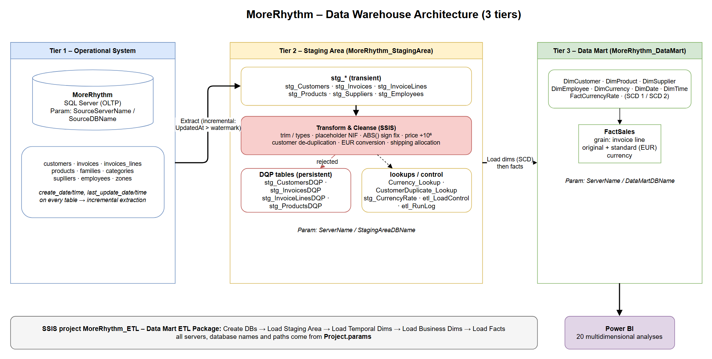

# MoreRhythm Data Mart – Part 1 Report: sections by Person A (1260224)

> Scope: data profiling, data warehouse architecture, EUR multi-currency standardisation,
> SSIS parameterisation, Staging Area and data quality structures, data quality rules,
> customer de-duplication and shipping-cost allocation.
> Related files: `SQL_Scripts/01_Data_Profiling.sql`, `SQL_Scripts/01_Data_Profiling_results.txt`,
> `SQL_Scripts/02_Create_Staging_Tables.sql`, `Design_Diagrams/Architecture_3Tier.drawio`,
> `SSIS/MoreRhythm_ETL/Project.params`.

---

## 1. Data Profiling

Profiling was run in SSMS against the operational database `MoreRhythm`
(script `01_Data_Profiling.sql`; raw output in `01_Data_Profiling_results.txt`).

### 1.1 Volumes

| Table | Rows | | Table | Rows |
|---|---:|---|---|---:|
| customers | 26 | | products | 67 |
| invoices | 37 | | suplliers | 14 |
| invoices_lines | 93 | | employees | 6 |
| families | 17 | | categories | 11 |
| zones | 5 | | stocks_movements / purchases | 686 / 18 |

The sample is small but, as stated in the brief, representative; the ETL is
designed for large volumes (set-based SQL, indexed staging keys, incremental extraction).

### 1.2 Customer tax numbers (`customers.taxpayer_number`)

| Finding | Records | Treatment |
|---|---|---|
| Placeholder tax numbers: `''`, `0`, `00`, `000000000` | 20, 24, 25 (internal branches), 2 ("Vendas a Dinheiro") | Not an error: set `TaxNumber = NULL`, keep the customer; excluded from NIF matching |
| **Exact duplicate** NIF `502323434` | 10 and 18 ("Eira e Beira, lda") | De-duplicate (rule M1) |
| **Near-duplicate** – NIF differs in 2 transposed digits, same zip, same/similar name | 5 ↔ 26 ("Coro Nossa Senhora Assunção" / "Coro N. Senhora Assunção"), 8 ↔ 22 ("Luz e Som, lda" / "Luz e Som Lda.") | De-duplicate (rule M2) |
| NIF fails the Portuguese modulo-11 check digit | 17 of 23 real NIFs | **Not** used as a rejection rule (would discard most of the sample); used only as a survivor tie-breaker and stored as `IsTaxNumberValid` |

### 1.3 Other customer attributes

* 1 invalid e-mail (`coro.sapo.pt`, customer 5) → set to NULL (the duplicate 26 has the valid `coro@sapo.pt`, recovered by survivorship).
* 12 customers without e-mail, 3 without city, 2 without zone (internal / cash-sale customers).
* Customer 21 (Spain): city empty, zip column holds `28108 Alcobendas - Madrid, España` → city/zip parsed; country derived from zone 5 = "Espanha".
* Zip codes hold *code + locality* (`2600-011 VILA FRANCA DE XIRA`) → split into `ZipCode` and `ZipLocality`.
* `seller` = 0 on 4 customers does not match any employee → kept as attribute only (not a FK).

### 1.4 Invoice timestamps

* `invoice_date` range 2025-01-31 … 2025-05-01; invoices are issued at month end (31-Jan, 28-Feb, 31-Mar, 30-Apr) plus one on 1-May.
* `created_at ≤ updated_at` holds for all invoices and lines.
* 36 of 37 invoices were updated after insertion and **all** have `last_update_date = payment_date` → invoices change after the sale (payment registration). The incremental load must therefore use `UpdatedAt`, not only `CreatedAt`.
* 1 invoice (`ADM06022859336,963953449`) has `create_date` 2025-02-28 but `invoice_date` 2025-03-31 (document created before its date – pre-dated draft). The business date for the fact is `invoice_date`; flagged in `QualityFlags`, not rejected.
* Invoice keys are `CHAR(25)` with trailing blanks and two prefixes (`ADM…` – 36, `cq0…` – 1) → `RTRIM` before lookup.

### 1.5 Amounts, currency and shipping

* `currency` holds only `'EURO'` (non-ISO) → mapped to `EUR`.
* Shipping cost is 2.5 % of `products_total` in 35 invoices; 2 invoices differ
  (`ADM06022868165,094314602`: 27.70 but `total_for_vat − products_total` = 25.20;
  `ADM06043059438,135478354`: 26.275 vs 21.275) → **rule S1**: when
  `shipping_cost ≠ total_for_vat − products_total`, use `total_for_vat − products_total`
  (the header's own arithmetic, which also drives the VAT and final total).
* 2 invoices have `products_total ≠ Σ line_total` (145 vs 140; 234 vs 239). In both the
  line totals are consistent with `vat_value` (`Σ line_vat = 23 % × Σ line_total`), so **lines are the
  source of truth** for the fact; the header value is only kept in staging.
* 4 lines have a negative `quantity` or `unit_price` while `line_total` is positive → sign
  error, auto-corrected with `ABS()`.
* All lines: implied VAT = 23 % = `products.vat_rate`.

### 1.6 Products / suppliers

* `current_sell_price` and `last_cost_price` are stored ×1 000 000 (e.g. 680 000 000 vs. line price 680) → divided by 10⁶.
* 2 "ghost" products (`Z001`, `CORSR`) with every attribute NULL and never sold → `stg_ProductsDQP`.
* 10 products without supplier → kept with the "Unknown supplier" member (`SupplierKey = -1`).
* Suppliers 8 and 14 share NIF `502199378` ("FaroInstrumentos" / "FaroInstrumentos II", different cities) → same company, two warehouses: kept as two suppliers (documented, not merged).

---

---

## 2. Data Warehouse Architecture

Three-tier architecture: operational system → Staging Area → Data Mart, consumed by Power BI
(diagram: `Design_Diagrams/Architecture_3Tier.drawio`).



**Tier 1 – Operational system (`MoreRhythm`).** The SQL Server database that supports billing,
purchasing and stock. Every table records `create_date/time` and `last_update_date/time`, which makes
incremental extraction possible. Server and database name are parameters (`SourceServerName`, `SourceDBName`).

**Tier 2 – Staging Area (`MoreRhythm_StagingArea`).** Intermediate database where the data is extracted,
cleaned and integrated before it reaches the Data Mart. It holds the transient `stg_*` tables, the persistent
`stg_*DQP` tables with the records that cannot be corrected automatically, the `_Lookup` tables, and the
ETL control tables (`etl_LoadControl`, `etl_RunLog`).

**Tier 3 – Data Mart (`MoreRhythm_DataMart`).** Star schema at the invoice-line grain: `FactSales`, `FactCurrencyRate`
and the dimensions Customer, Product, Supplier, Employee, Currency, Date and Time. It is the source for the
Power BI analyses. The Staging Area and the Data Mart are on the **same server** (`ServerName`), as the brief requires.

**ETL flow** (SSIS project `MoreRhythm_ETL`, one package `Data Mart ETL Package` organised in sequence containers, as in the labs):

1. **Create databases and tables**: creates the Staging Area and Data Mart databases if they don't exist
   and runs the `SQL Scripts` for their tables.
2. **Load Staging Area**: extracts only the rows whose `UpdatedAt` is greater than the watermark in
   `etl_LoadControl` (plus their parent/child rows) into the `stg_*` tables.
3. **Transform & cleanse**: type conversion, trimming, placeholder handling, sign correction, price-scale
   correction, currency conversion, customer de-duplication and shipping allocation. Records that cannot be
   corrected automatically go to the `stg_*DQP` table with a `DQP` message and leave the flow (Conditional
   Split / Lookup error output → Derived Column "Add … DQP" → Union All → OLE DB Destination, as in lab 4).
4. **Load Temporal Dimensions**: `DimDate` and `DimTime`, loaded once from CSV files.
5. **Load Business Dimensions**: Slowly Changing Dimension component (Type 1 / Type 2 per attribute).
6. **Load Fact Tables**: `FactCurrencyRate`, then `FactSales` with surrogate-key lookups. New lines are
   inserted and changed lines updated (matched on `InvoiceLineID`). The watermarks only move forward if the run succeeds.
---

## 3. EUR Multi-Currency Standardisation

Requirement: the company will expand to other EU countries and to the UK, so
the Data Mart uses the **euro as the reporting currency** while still allowing
analysis by original currency.

**Design** (the "Multiple Currencies" technique from the Dimensional Data
Modeling slides, also used in the resolution of modelling exercise 4):

1. **Normalise the currency code.** Source values are free text (`'EURO'`). A
   Lookup against `Currency_Lookup` maps them to ISO-4217 codes
   (`EURO → EUR`; later `LIBRA`/`GBP → GBP`, etc.). A currency with no match
   cannot be corrected automatically → `stg_InvoicesDQP` (`I06: unknown currency`).
2. **Currency dimension** `DimCurrency(CurrencyKey, Code, Name, Symbol)`: the
   fact references the currency in which the invoice was issued.
3. **Pairs of facts.** Each money fact of `FactSales` is stored twice: in the
   **original (local) currency** and in the **standard currency (EUR)**:
   `UnitPrice…`, `Amount…` (excl. VAT), `VATAmount…`, `TotalAmount…` (incl. VAT),
   `ShippingCost…` (allocated), each with the suffix `OriginalCurrency` or
   `StandardCurrency`. EUR facts can be added across all invoices; original facts
   can be analysed by filtering on one currency.
4. **Currency conversion fact table** `FactCurrencyRate(DateKey, SourceCurrencyKey,
   DestinationCurrencyKey, SourceDestinationExchangeRate, DestinationSourceExchangeRate)`
   keeps the daily rates in **both directions**, because the two directions are not
   always symmetric. This lets analyses be shown in any currency the user selects,
   not only EUR. Rates are loaded from a daily rates file (e.g. ECB reference rates)
   into `stg_CurrencyRate`; EUR → EUR has rate 1 for every date.
5. **Conversion at load time**: the rate used is the one for the invoice date
   (or the latest earlier date with a rate):

   ```sql
   SELECT TOP (1) r.SourceDestinationExchangeRate
   FROM FactCurrencyRate r
   JOIN DimDate d ON d.DateKey = r.DateKey
   WHERE r.SourceCurrencyKey = @InvoiceCurrencyKey
     AND r.DestinationCurrencyKey = @EURKey
     AND d.FullDate <= @InvoiceDate
   ORDER BY d.FullDate DESC;
   -- <Fact>StandardCurrency = <Fact>OriginalCurrency × rate
   ```
6. The rate is fixed at load time (the historical rate of the invoice date). If a
   rate is corrected later, the invoice's `UpdatedAt` does not change, so the affected
   period has to be reloaded manually. This is a documented limitation.

With the current data all invoices are EUR (rate = 1), so both values of every pair
are equal. The mechanism is in place for the expansion to the UK.

---

## 5. Staging Area Structures

Created by `02_Create_Staging_Tables.sql` in database `MoreRhythm_StagingArea`.

| Table | Kind | Content |
|---|---|---|
| `stg_Customers` | transient | cleaned customers (+ `SurvivorCustomerID`, normalised name, NIF validity) |
| `stg_Invoices` | transient | invoice headers, ISO currency, rate, corrected shipping, `SumLinesTotal` |
| `stg_InvoiceLines` | transient | **fact grain**: line measures, allocated shipping, all EUR measures |
| `stg_Products`, `stg_Suppliers`, `stg_Employees` | transient | dimension sources, already joined with family/category/zone/manager |
| `stg_CustomersDQP`, `stg_InvoicesDQP`, `stg_InvoiceLinesDQP`, `stg_ProductsDQP` | persistent | Data Quality Problem tables (course convention, lab 4 `CardDQP`): rejected rows (raw values as NVARCHAR) + `DQP` (problem code and description), `DQPDate`, `RunID` |
| `CustomerDuplicate_Lookup` | persistent | source customer id → surviving id (de-duplication result) |
| `Currency_Lookup` | persistent | source currency text → ISO code (`EURO` → `EUR`) |
| `stg_CurrencyRate` | transient | daily exchange rates, source of `FactCurrencyRate` |
| `etl_LoadControl` | persistent | incremental watermark (`LastUpdatedAt`) per source table |
| `etl_RunLog` | persistent | one row per ETL execution |

Every staging/error row carries `CreatedAt` / `UpdatedAt` (source `*_date + *_time`
combined into `DATETIME2`) and `RunID` for lineage.


### 5.1 Table structures

The staging tables keep the source business keys (`CustomerID`, `InvoiceID`, `InvoiceLineID`, `ProductID`, …)
so that the ETL can look up surrogate keys and match changed rows. `CreatedAt` / `UpdatedAt` drive the
incremental load, and `RunID` links each row to its row in `etl_RunLog`.

**stg_Customers**

| Column | Type | Null | Key |
|---|---|---|---|
| CustomerID | numeric(10,0) | no | PK |
| SurvivorCustomerID | numeric(10,0) | yes |  |
| CustomerName | nvarchar(55) | no |  |
| CustomerNameNorm | nvarchar(55) | yes |  |
| TaxNumber | varchar(20) | yes |  |
| IsTaxNumberValid | bit | yes |  |
| Phone | varchar(20) | yes |  |
| Mobile | varchar(20) | yes |  |
| ContactName | nvarchar(30) | yes |  |
| Email | varchar(45) | yes |  |
| Address | nvarchar(55) | yes |  |
| City | nvarchar(43) | yes |  |
| ZipCode | varchar(10) | yes |  |
| ZipLocality | nvarchar(40) | yes |  |
| Country | nvarchar(30) | yes |  |
| ZoneCode | numeric(5,0) | yes |  |
| ZoneName | nvarchar(50) | yes |  |
| CustomerType | nvarchar(20) | no |  |
| Segment | nvarchar(25) | no |  |
| SellerCode | numeric(4,0) | yes |  |
| DaysToPay | numeric(3,0) | yes |  |
| BBAN | varchar(28) | yes |  |
| CreatedAt | datetime2(0) | no |  |
| UpdatedAt | datetime2(0) | no |  |
| RunID | int | yes |  |

**stg_Invoices**

| Column | Type | Null | Key |
|---|---|---|---|
| InvoiceID | varchar(25) | no | PK |
| InvoiceDate | date | no |  |
| CustomerID | numeric(10,0) | no |  |
| SurvivorCustomerID | numeric(10,0) | yes |  |
| EmployeeID | numeric(6,0) | no |  |
| PaymentDate | date | yes |  |
| CurrencySource | varchar(11) | no |  |
| CurrencyCode | char(3) | no |  |
| ExchangeRateToEUR | decimal(19,10) | no |  |
| ProductsTotal | decimal(19,6) | no |  |
| ShippingCost | decimal(19,6) | no |  |
| TotalForVAT | decimal(19,6) | no |  |
| VATValue | decimal(19,6) | no |  |
| FinalTotal | decimal(19,6) | no |  |
| SumLinesTotal | decimal(19,6) | yes |  |
| ShippingCostEUR | decimal(19,6) | yes |  |
| QualityFlags | varchar(200) | yes |  |
| CreatedAt | datetime2(0) | no |  |
| UpdatedAt | datetime2(0) | no |  |
| RunID | int | yes |  |

**stg_InvoiceLines**

| Column | Type | Null | Key |
|---|---|---|---|
| InvoiceLineID | varchar(25) | no | PK |
| InvoiceID | varchar(25) | no |  |
| ProductID | varchar(18) | no |  |
| Quantity | decimal(14,4) | no |  |
| UnitPrice | decimal(19,6) | no |  |
| LineTotal | decimal(19,6) | no |  |
| LineVAT | decimal(19,6) | no |  |
| VATRate | decimal(5,2) | yes |  |
| ShippingAllocated | decimal(19,6) | yes |  |
| UnitPriceEUR | decimal(19,6) | yes |  |
| LineTotalEUR | decimal(19,6) | yes |  |
| LineVATEUR | decimal(19,6) | yes |  |
| LineTotalWithVATEUR | decimal(19,6) | yes |  |
| ShippingAllocatedEUR | decimal(19,6) | yes |  |
| QualityFlags | varchar(200) | yes |  |
| CreatedAt | datetime2(0) | no |  |
| UpdatedAt | datetime2(0) | no |  |
| RunID | int | yes |  |

**stg_Products**

| Column | Type | Null | Key |
|---|---|---|---|
| ProductID | varchar(18) | no | PK |
| ProductName | nvarchar(60) | no |  |
| FamilyCode | varchar(18) | yes |  |
| FamilyName | nvarchar(60) | yes |  |
| FamilyClassification | nvarchar(20) | yes |  |
| CategoryCode | int | yes |  |
| CategoryName | nvarchar(35) | yes |  |
| SupplierID | numeric(10,0) | yes |  |
| Classification | nvarchar(20) | yes |  |
| CurrentSellPrice | decimal(19,6) | yes |  |
| LastCostPrice | decimal(19,6) | yes |  |
| VATRate | decimal(5,2) | yes |  |
| CreatedAt | datetime2(0) | yes |  |
| UpdatedAt | datetime2(0) | yes |  |
| RunID | int | yes |  |

**stg_Suppliers**

| Column | Type | Null | Key |
|---|---|---|---|
| SupplierID | numeric(10,0) | no | PK |
| SupplierName | nvarchar(55) | no |  |
| TaxNumber | varchar(20) | yes |  |
| City | nvarchar(43) | yes |  |
| ZipCode | varchar(10) | yes |  |
| Country | nvarchar(30) | yes |  |
| ZoneCode | numeric(5,0) | yes |  |
| ZoneName | nvarchar(50) | yes |  |
| SupplierType | nvarchar(20) | yes |  |
| Nationality | nvarchar(20) | yes |  |
| CreatedAt | datetime2(0) | yes |  |
| UpdatedAt | datetime2(0) | yes |  |
| RunID | int | yes |  |

**stg_Employees**

| Column | Type | Null | Key |
|---|---|---|---|
| EmployeeID | numeric(6,0) | no | PK |
| EmployeeCode | varchar(20) | no |  |
| EmployeeName | nvarchar(30) | no |  |
| EmployeeGroup | nvarchar(20) | yes |  |
| Department | nvarchar(20) | yes |  |
| ManagerID | numeric(6,0) | yes |  |
| ManagerName | nvarchar(30) | yes |  |
| Email | varchar(100) | yes |  |
| CreatedAt | datetime2(0) | yes |  |
| UpdatedAt | datetime2(0) | yes |  |
| RunID | int | yes |  |

**stg_CurrencyRate**

| Column | Type | Null | Key |
|---|---|---|---|
| CurrencyCode | nchar(3) | no | PK |
| RateDate | date | no | PK |
| RateToEUR | decimal(18,6) | no |  |

**Currency_Lookup**

| Column | Type | Null | Key |
|---|---|---|---|
| SourceCurrency | nvarchar(11) | no | PK |
| CurrencyCode | nchar(3) | no |  |

**CustomerDuplicate_Lookup**

| Column | Type | Null | Key |
|---|---|---|---|
| SourceCustomerID | numeric(10,0) | no | PK |
| SurvivorCustomerID | numeric(10,0) | no |  |
| MatchRule | nvarchar(30) | no |  |
| MatchScore | decimal(5,4) | yes |  |
| RunID | int | yes |  |

**etl_LoadControl**

| Column | Type | Null | Key |
|---|---|---|---|
| SourceTable | varchar(50) | no | PK |
| LastUpdatedAt | datetime2(0) | no |  |
| LastRunID | int | yes |  |
| LastRunTime | datetime2(0) | yes |  |

**etl_RunLog**

| Column | Type | Null | Key |
|---|---|---|---|
| RunID | int | no | PK |
| PackageName | nvarchar(128) | no |  |
| StartTime | datetime2(0) | no |  |
| EndTime | datetime2(0) | yes |  |
| Status | varchar(10) | no |  |
| RowsExtracted | int | yes |  |
| RowsRejected | int | yes |  |
| RowsLoaded | int | yes |  |


**DQP tables** (`stg_CustomersDQP`, `stg_InvoicesDQP`, `stg_InvoiceLinesDQP`, `stg_ProductsDQP`) follow the
lab convention (`CardDQP`). Each has the same columns as the source table, stored as `NVARCHAR` so that values
with the wrong type or length can still be kept, plus:

| Column | Type | Null | Description |
|---|---|---|---|
| DQPID | int identity | no | primary key |
| DQP | nvarchar(200) | no | problem code and description, e.g. `C01: customer name is missing` |
| DQPDate | datetime | no | when the record was rejected (default `GETDATE()`) |
| RunID | int | yes | ETL execution that rejected it |

These tables are never truncated. Correcting the records and loading them later is out of the scope of this work, as the brief states.

### 5.2 Data quality problems and how each is handled

Every problem found by profiling (or that the ETL must guard against on future
data) gets one of three treatments:

* **AUTO-CORRECT**: the ETL can repair the value deterministically. The record is loaded. For invoices and lines the fix is also noted in the `QualityFlags` column of `stg_Invoices` / `stg_InvoiceLines`.
* **FLAG**: the value is suspicious but not wrong enough to block the record. The record is loaded unchanged and flagged.
* **REJECT**: no automatic correction is possible. The record is written to the matching `stg_<Table>DQP` table with a `DQP` message (problem code + description), removed from `stg_*`, and **never loaded into the Data Mart**, as the brief requires. Correcting and reloading rejected records is out of scope.

"Rows in sample" is the number of records affected in the data provided
(`01_Data_Profiling_results.txt`); 0 means the rule is a safeguard for future loads.

#### Customers (`customers` → `stg_Customers` / `stg_CustomersDQP`)

| Code | Problem | Attribute(s) | Rows in sample | Treatment | How |
|---|---|---|---:|---|---|
| C01 | Name missing | name | 0 | REJECT → `stg_CustomersDQP` | a customer cannot be identified without a name |
| C02 | Placeholder tax number (`''`, `0`, `00`, `000000000`) | taxpayer_number | 4 (ids 2, 20, 24, 25) | AUTO-CORRECT | `TaxNumber = NULL` in staging, `'N/A'` in DimCustomer; record kept (internal branches / cash sales); excluded from NIF matching |
| C03 | Invalid e-mail format (no `@`) | email | 1 (id 5: `coro.sapo.pt`) | AUTO-CORRECT | `Email = NULL`; then recovered from duplicate id 26 (`coro@sapo.pt`) by survivorship |
| C04 | Zone missing | zone | 2 (ids 2, 20) | AUTO-CORRECT | `Zone = 'Unknown'`, `Country = 'Unknown'` |
| C05 | Exact duplicate (same NIF) | taxpayer_number | 1 group (ids 10, 18) | AUTO-CORRECT (merge) | de-duplication rule M1 (Section 6) |
| C06 | Near-duplicate (NIF typo, name variant, same zip) | name, taxpayer_number, zip_code | 2 groups (5 ↔ 26, 8 ↔ 22) | AUTO-CORRECT (merge) | de-duplication rule M2 (Section 6) |
| C07 | NIF fails modulo-11 check digit | taxpayer_number | 17 of 23 | FLAG | `IsTaxNumberValid = 0`; used only to pick the survivor (rejecting would discard most customers) |
| C08 | City missing | clity | 3 (ids 2, 20, 21) | AUTO-CORRECT | id 21: city parsed from zip text ("Alcobendas - Madrid"); others → `'Unknown'` |
| C09 | Zip code and locality stored together; foreign format | zip_code | 24 / 1 foreign (id 21) | AUTO-CORRECT | split into `ZipCode` (`NNNN-NNN`) + `ZipLocality`; foreign codes kept as they are |
| C10 | Seller code does not match an employee | seller | 4 (seller = 0) | FLAG | kept as a descriptive attribute only, not used as a foreign key |
| C11 | Text with extra spaces / inconsistent case | all text | all | AUTO-CORRECT | `LTRIM/RTRIM`; empty string → NULL in staging, `'N/A'` in the Data Mart |

#### Products and suppliers (`products`, `suplliers` → `stg_Products`, `stg_Suppliers` / `stg_ProductsDQP`)

| Code | Problem | Attribute(s) | Rows in sample | Treatment | How |
|---|---|---|---:|---|---|
| P01 | Product with every descriptive attribute NULL | designation, family, category | 2 (`Z001`, `CORSR`) | **REJECT → `stg_ProductsDQP`** | never sold, so nothing cascades to sales |
| P02 | Price stored ×1 000 000 | current_sell_price, last_cost_price | 65 (all non-null) | AUTO-CORRECT | ÷ 1 000 000 (checked against line `unit_price`: ratio = 10⁶) |
| P03 | Product without supplier | supplyer | 10 | AUTO-CORRECT | `SupplierKey = -1` (Unknown member of DimSupplier) |
| P04 | Product reference with trailing blanks (`CHAR(18)`) | reference | all | AUTO-CORRECT | `RTRIM` before lookups |
| S01 | Two suppliers share a NIF | taxpayer_number | 1 pair (8, 14 "FaroInstrumentos"/"II") | FLAG | different cities, so treated as two warehouses of one company; not merged |
| S02 | Supplier zone / city missing | zone, city | 2 (3 "Compras a Dinheiro", 13 internal) | AUTO-CORRECT | `Zone`, `City`, `Country = 'Unknown'` |

#### Invoices (`invoices` → `stg_Invoices` / `stg_InvoicesDQP`)

| Code | Problem | Attribute(s) | Rows in sample | Treatment | How |
|---|---|---|---:|---|---|
| I01 | Invoice date NULL or in the future | invoice_date | 0 | REJECT → `stg_InvoicesDQP` | no valid date means no `DateKey` |
| I02 | Invoice without lines | — | 0 | REJECT → `stg_InvoicesDQP` | nothing to load at the fact grain |
| I03 | Customer or employee not found | customer, employee | 0 | REJECT → `stg_InvoicesDQP` | broken foreign key |
| I04 | Shipping ≠ `total_for_vat − products_total` | shipping_cost | 2 | AUTO-CORRECT | rule S1: use `total_for_vat − products_total` |
| I05 | `products_total` ≠ Σ `line_total` | products_total | 2 | FLAG | lines are consistent with the VAT, so lines are used for the fact |
| I06 | Currency not ISO / unknown / no exchange rate | currency | 37 non-ISO (`EURO`), 0 unknown | AUTO-CORRECT (`EURO → EUR`); unknown currency → REJECT | mapping through `Currency_Lookup` |
| I07 | Record created before its invoice date | create_date | 1 | FLAG | `invoice_date` is the business date for the fact |
| I08 | Payment date before invoice date | payment_date | 0 | FLAG | safeguard |
| I09 | Created after updated | create_*, last_update_* | 0 | FLAG | safeguard (would break the incremental watermark) |
| I10 | Invoice key padded to `CHAR(25)` | invoice_stamp_id | 37 | AUTO-CORRECT | `RTRIM` |

#### Invoice lines (`invoices_lines` → `stg_InvoiceLines` / `stg_InvoiceLinesDQP`)

| Code | Problem | Attribute(s) | Rows in sample | Treatment | How |
|---|---|---|---:|---|---|
| L01 | Negative quantity or unit price while `line_total` is positive | quantity, unit_price | 4 | AUTO-CORRECT | `ABS()` (sign entry error; `line_total` and VAT confirm the positive value) |
| L02 | Product not found or rejected (P01) | product | 0 | REJECT → `stg_InvoiceLinesDQP` | no `ProductKey` |
| L03 | `|quantity × unit_price| ≠ line_total` (beyond 0.01) | line_total | 0 | REJECT → `stg_InvoiceLinesDQP` | the correct amount cannot be known |
| L04 | Line belongs to a rejected invoice | invoice_stamp_id | 0 | REJECT → `stg_InvoiceLinesDQP` (cascade) | keeps fact and header consistent |
| L05 | VAT NULL or ≠ `line_total × vat_rate` | line_vat | 0 (all 23 %) | NULL → AUTO-CORRECT (recompute from rate); mismatch → FLAG | |

**Result on the provided sample:** 2 records are rejected (products `Z001`
and `CORSR`, which were never sold). Every customer, invoice and invoice line can be
corrected automatically, so the Data Mart receives 23 customers (after merging 3
duplicate pairs), 37 invoices and all 93 lines, with shipping and amounts
reconciled.


#### Transformations that make values explicit (no data quality problem)

As in lab 4 (`Gender` F → Female), every code is replaced by a value whose meaning is clear at analysis time:

| Code | Source | Data Mart | Transformation |
|---|---|---|---|
| T01 | `customers.zone`, `suplliers.zone` (1–5) | `Zone` | Lookup on `zones` → Norte, Centro, Sul, Ilhas, Espanha |
| T02 | zone | `Country` | derived: Espanha → Spain, other zones → Portugal |
| T03 | `products.family` (reference) | `FamilyName`, `FamilyClassification` | Lookup on `families` |
| T04 | `products.category` (code) | `CategoryName` | Lookup on `categories` |
| T05 | `employees.chief` (number) | `ManagerName` | self-lookup on `employees`; `'N/A'` for top management |
| T06 | `employees.[group]` | `Role` | renamed attribute (Vendedor, Administrativo, Administrador) |
| T07 | `invoices.currency` (`EURO`) | `DimCurrency.Code`, `Name`, `Symbol` | `Currency_Lookup` → ISO code → DimCurrency |
| T08 | dates / times | `Weekend`, `LastDayOfMonth`, `LunchTime`, `DinnerTime` | `'Yes'` / `'No'` instead of 1/0 |
| T09 | `create_date` + `create_time`, `last_update_date` + `last_update_time` | `CreatedAt`, `UpdatedAt` (staging) | combined into one `DATETIME2` |
| T10 | `zip_code` (`2600-011 VILA FRANCA DE XIRA`) | `PostalCode` + locality | split on the first space after the `NNNN-NNN` code |

---

## 6. Customer De-duplication Algorithm

**Input:** `stg_Customers` (new/changed customers) and the customers already in
`DimCustomer`. **Output:** `CustomerDuplicate_Lookup` (every source id → survivor id) and
one surviving, merged record per real customer.

1. **Standardise** every record:
   * `NameNorm` = UPPER, accent-insensitive (`COLLATE Latin1_General_CI_AI`),
     punctuation removed, legal suffixes removed (`LDA`, `S.A.`, `UNIPESSOAL`),
     abbreviations expanded (`N.` → `NOSSA`, `SRA` → `SENHORA`, `R.` → `RUA`, `AV.` → `AVENIDA`), multiple spaces collapsed;
   * `AddressNorm` the same way; `Phone`/`Mobile` → digits only;
   * `ZipCode` = first 8 characters (`NNNN-NNN`);
   * `TaxNumber` = NULL if blank or only zeros (rule C02); `IsTaxNumberValid` = modulo-11 check.
2. **Exclude non-matchable records** from the comparison: customers of type
   `Interno` and generic customers ("Vendas a Dinheiro") – each is its own survivor.
3. **Blocking** (to avoid comparing all n² pairs on large volumes): only compare
   records that share **NIF**, or **ZipCode**, or **Phone**.
4. **Matching rules** for each candidate pair (A, B):
   * **M1 – exact identifier:** `A.TaxNumber = B.TaxNumber` (not NULL) → duplicate, score 1.0.
   * **M2 – fuzzy:** same `ZipCode` **and** name similarity ≥ 0.80
     (SSIS *Fuzzy Grouping* on `NameNorm`, `AddressNorm`) **and** at least one
     corroborating evidence: NIF differs in ≤ 2 digits, **or** same phone, **or**
     address similarity ≥ 0.80 → duplicate, score = similarity.
   * Otherwise → distinct customers.
5. **Clustering:** take the transitive closure of the matched pairs (if A≈B and
   B≈C then {A,B,C} is one group).
6. **Survivor selection** inside each group, in order:
   1. record already present in `DimCustomer` (keeps the surrogate key stable);
   2. record with a valid NIF check digit;
   3. most complete record (largest number of non-empty attributes);
   4. earliest `CreatedAt` (the original registration);
   5. lowest `CustomerID`.
7. **Survivorship per attribute:** survivor values win; empty/invalid survivor
   attributes are filled from the other members with the most recent `UpdatedAt`
   (e.g. customer 5's invalid e-mail is replaced by customer 26's `coro@sapo.pt`).
8. **Persist** `CustomerDuplicate_Lookup(SourceCustomerID, SurvivorCustomerID, MatchRule, MatchScore)`;
   only survivors are loaded into `DimCustomer`.
9. **Re-key facts:** `stg_Invoices.SurvivorCustomerID` is set through the map, so
   sales of all duplicates are attributed to the same `CustomerKey`.
10. **Incremental runs:** new customers are matched against `DimCustomer` as
    well; an existing map entry is never re-pointed automatically (manual review).

**Result on the provided data** (validated in SQL): 3 groups, 0 false positives –
{10, 18} by M1, {5, 26} and {8, 22} by M2. 26 source customers → 23 customers in the Data Mart.

**Survivor of each group** (rules of step 6 applied to the data; none of them is in `DimCustomer` yet, and none has a valid check digit except group 1, where both NIFs are equal and valid):

| Group | Members | Rule | Completeness (filled contact/address fields) | Survivor | Reason |
|---|---|---|---|---|---|
| 1 | 10, 18 "Eira e Beira, lda" | M1 | 6 / 6 | **10** | tie on completeness → created first (2025-03-31 vs 2025-05-31) |
| 2 | 5 "Coro Nossa Senhora Assunção", 26 "Coro N. Senhora Assunção" | M2 | 5 / 6 | **26** | more complete (valid e-mail, mobile); customer 5's contact name is kept by attribute survivorship |
| 3 | 8 "Luz e Som, lda", 22 "Luz e Som Lda." | M2 | 5 / 5 | **8** | tie on completeness → created first (2025-04-30 vs 2025-06-30); phone taken from 22 |

**Validation query** (finds the candidate pairs with rules M1 and M2; result: exactly the 3 pairs above):

```sql
WITH c AS (
  SELECT number, zip_code,
         LTRIM(RTRIM(REPLACE(REPLACE(REPLACE(REPLACE(REPLACE(REPLACE(
             UPPER(name) COLLATE Latin1_General_CI_AI, ',', ' '), '.', ' '), ' LDA', ' '),
             ' S A', ' '), ' N ', ' NOSSA '), '  ', ' '))) AS NameNorm,
         taxpayer_number AS nif,
         CASE WHEN taxpayer_number LIKE '%[^0]%' AND LEN(taxpayer_number) = 9 THEN 1 ELSE 0 END AS real_nif
  FROM MoreRhythm.dbo.customers
)
SELECT a.number AS customer_a, b.number AS customer_b,
       CASE WHEN a.real_nif = 1 AND a.nif = b.nif THEN 'M1' ELSE 'M2' END AS match_rule
FROM c a JOIN c b ON a.number < b.number
WHERE (a.real_nif = 1 AND a.nif = b.nif)
   OR (a.zip_code = b.zip_code AND a.zip_code <> '' AND DIFFERENCE(a.NameNorm, b.NameNorm) = 4);
```

In SSIS, the same matching is done with the **Fuzzy Grouping** transformation on `NameNorm`, `AddressNorm`
and `ZipCode` (exact match on `ZipCode`), with a similarity threshold of 0.80.

---

## 7. Shipping-Cost Allocation Formula

Shipping is recorded only on the invoice header; the fact grain is the invoice
line, so the cost is allocated **proportionally to the line value excluding VAT**.

For invoice *i* with lines *j = 1…nᵢ*:

$$
\text{Ship}_{i}^{*} =
\begin{cases}
\text{TotalForVAT}_i - \text{ProductsTotal}_i & \text{if } \text{ShippingCost}_i \neq \text{TotalForVAT}_i - \text{ProductsTotal}_i \ (\text{rule S1})\\
\text{ShippingCost}_i & \text{otherwise}
\end{cases}
$$

$$
\text{ShippingAllocated}_{ij} = \operatorname{round}_6\!\left(\text{Ship}_{i}^{*} \times \frac{\text{LineTotal}_{ij}}{\sum_{k=1}^{n_i}\text{LineTotal}_{ik}}\right)
$$

Rounding residual (so the line shares add up exactly to the header):

$$
\text{ShippingAllocated}_{i,j^{*}} \mathrel{+}= \text{Ship}_{i}^{*} - \sum_{j=1}^{n_i}\text{ShippingAllocated}_{ij},
\qquad j^{*} = \arg\max_j \text{LineTotal}_{ij}
$$

$$
\text{ShippingCostOriginalCurrency}_{ij} = \text{ShippingAllocated}_{ij}, \qquad
\text{ShippingCostStandardCurrency}_{ij} = \text{ShippingAllocated}_{ij} \times \text{rate}_{i \to EUR}
$$

**Why proportional and not an equal split.** The slides ("Header & Line Facts
with Different Granularities") use the lab example to show that the header value
must not be copied to every line. Copying freight 15 to 3 lines would sum to 45.
The example splits it equally (5 + 5 + 5). We use the same allocation idea, but
weight by line value. A 1 322 € guitar line and a 56 € case line on the same
invoice should not carry the same shipping cost. Both methods keep the total
exact (Σ lines = header).

Notes
* `LineTotal` is used **after** the sign correction (L01), so weights are never negative.
* If `Σ LineTotal = 0` (all lines free of charge) the cost is split by quantity:
  `Ship* × Quantity_ij / Σ Quantity_ik`.
* The denominator is the **sum of the lines** (not the header `products_total`,
  which is wrong in 2 invoices), guaranteeing `Σ_j ShippingAllocated_ij = Ship*_i`.
* Worked example – invoice `ADM06013159066,541488606`, shipping 51.45, lines 680 + 56 + 1322 = 2058:
  680/2058 × 51.45 = 17.00; 56/2058 × 51.45 = 1.40; 1322/2058 × 51.45 = 33.05; total 51.45.
* Validation on the full sample (37 invoices, 93 lines): Σ allocated = 990.395 = Σ invoice shipping, and the line shares of every invoice add up exactly to its shipping cost (0 mismatches).

SQL implementation (used in `Pkg_02_Transform`):

```sql
WITH l AS (
  SELECT l.InvoiceLineID, l.InvoiceID, l.LineTotal, i.ShippingCost,
         SUM(l.LineTotal) OVER (PARTITION BY l.InvoiceID) AS SumLines,
         ROW_NUMBER() OVER (PARTITION BY l.InvoiceID ORDER BY l.LineTotal DESC, l.InvoiceLineID) AS rn
  FROM stg_InvoiceLines l JOIN stg_Invoices i ON i.InvoiceID = l.InvoiceID
), a AS (
  SELECT *, ROUND(ShippingCost * LineTotal / NULLIF(SumLines,0), 6) AS Alloc FROM l
), b AS (
  SELECT InvoiceLineID,
         Alloc + CASE WHEN rn = 1 THEN ShippingCost - SUM(Alloc) OVER (PARTITION BY InvoiceID) ELSE 0 END AS AllocFinal
  FROM a
)
UPDATE t SET ShippingAllocated = b.AllocFinal
FROM stg_InvoiceLines t JOIN b ON b.InvoiceLineID = t.InvoiceLineID;
```
